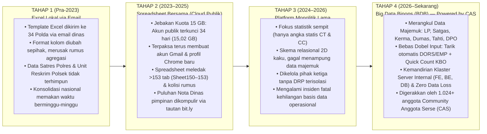
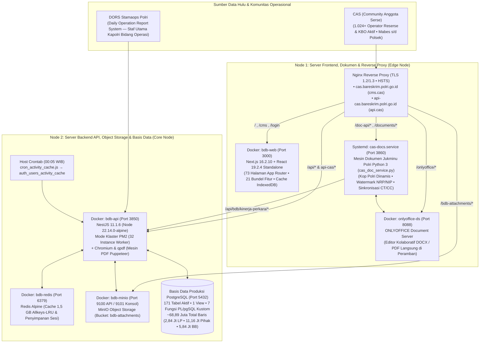

# Big Data Binops (BDB) — Powered by CAS (*Community Anggota Serse*)

> 🌐 **Pilihan Bahasa / Language:** [**🇮🇩 Bahasa Indonesia (Aktif)**](README.id.md) &nbsp;|&nbsp; [**🇬🇧 English Version**](README.md)

[%20v2.5-1E40AF.svg?style=flat-square)](#)
[-25D366.svg?style=flat-square&logo=whatsapp&logoColor=white)](#-kisah-evolusi-dari-analis-data-menjadi-full-stack-system-architect)
[](https://www.typescriptlang.org/)
[](https://nestjs.com/)
[](https://nextjs.org/)
[%20%7C%20Redis-336791.svg?style=flat-square&logo=postgresql&logoColor=white)](https://www.postgresql.org/)
[](#3-mesin-dokumen-13-lembar-perkap--jukminu-polri--integrasi-onlyoffice)
[](#4-autentikasi-biometrik-fido2--webauthn-passkey--keamanan-zero-trust)
[](LICENSE)

**Big Data Binops (BDB)** adalah platform tata kelola data operasional berskala *enterprise*, manajemen siklus hidup perkara lintas sumber, serta analitik penegakan hukum yang dirancang dan dibangun untuk **Biro Pembinaan dan Operasional (Robinopsnal) Bareskrim Polri**.

Lahir dari **CAS (*Community Anggota Serse*)** — sebuah gerakan dan komunitas operasional akar rumput yang menghimpun **1.024+ penyidik aktif, operator, Kanit Reskrim Polsek, hingga Kaur Binops (KBO)** di seluruh Indonesia — **Big Data Binops (BDB)** mengonsolidasikan **~68,89 juta rekaman basis data produksi aktif** (**2,84+ juta Laporan Polisi / LP**, **11,16+ juta pihak terlibat**, **5,84+ juta barang bukti**, dan **5,46+ juta catatan audit forensik**) di seluruh 4 tingkatan kewilayahan (**Mabes Polri → 36 Polda → 508+ Polres → 4.900+ Polsek**).

---

## 💡 Kisah Evolusi: Dari Analis Data Menjadi *Full-Stack System Architect*

Platform ini tidak dibangun dari spesifikasi teoretis di atas kertas semata — melainkan direkayasa langsung dari nol oleh seorang **Analis Data Operasional yang bertransformasi menjadi *Full-Stack Engineer*** setelah mengalami sendiri setiap tahapan kerapuhan tata kelola data di lingkungan Robinopsnal Bareskrim Polri:



### Mengapa Transformasi **CAS (*Community Anggota Serse*)** → **Big Data Binops (BDB)** Sangat Krusial?
1. **Adopsi Operasional dari Bawah ke Atas (*Bottom-Up via CAS — Community Anggota Serse*)**: Alih-alih memaksakan aplikasi instruksional dari atas yang membebani penyidik dengan pengisian ganda (*beban dobel input*), **CAS** menghubungkan **1.024+ personil Reserse aktif** dalam satu lingkar komunikasi langsung (Grup WhatsApp Komunitas berkapasitas penuh & forum taktis internal **SHARESE**). Operator kewilayahan melaporkan langsung anomali pemekaran Satker, kendala pelimpahan LP, maupun kebutuhan fitur lapangan untuk segera diselesaikan di dalam **Big Data Binops (BDB)**.
2. **Keselarasan Penuh dengan SOTK Polri (`Perkap 6/2017 jo. Perpol 4/2025`)**: Menyatukan alur kerja keempat Bagian inti di lingkungan **Robinopsnal Bareskrim Polri**:
   - **Bagrenopsnal (*Perencanaan & Pelatihan Operasi*)**: Modul Operasi Kepolisian & Satgas (`bdb_operasi_satgas` — 12 Satgas aktif), penandaan LP operasi (`operasi_satgas_id`), repositori PDF *Sprin & Renops* di MinIO S3, serta diseminasi *Jukrah* komando terenkripsi.
   - **Bagkerma (*Kerja Sama Dalam & Luar Negeri*)**: Bank Data Kerma (`bdb_kerma_master` untuk penyimpanan MoU/PKS bersama Kementerian/Lembaga, BUMN, Perbankan, dan instansi luar negeri) lengkap dengan alarm peringatan kedaluwarsa otomatis (**H-180 s/d H-30**).
   - **Baganev (*Penyajian Data & Pengendalian Perkara*)**: Mesin analitik CT/CP/CC/CR & Indeks Kinerja berkecepatan $<100\text{ ms}$, **Mesin SLA Perkap 6/2019** (*Mudah 30 hari* s/d *Sangat Sulit 120 hari*), *Radar Kasus Menonjol (Susjol)* & *Kasus Atensi Pimpinan*, serta **Intelijen Sindikat Lintas Wilayah** (`is_lintas_wilayah` — **5.828 subjek hukum beraksi di multi-Polda**).
   - **Bagyanmas (*Pelayanan Pengaduan Masyarakat*)**: Kanal penerimaan surat Pengaduan Masyarakat (*Dumas*) non-LP dengan verifikasi **NIK kependudukan**, pelacakan mandiri melalui *QR-Code*, serta kepastian penerbitan **SP2HP-Dumas** (*Quick Win Presisi*).
3. **Terbukti dalam Rekonsiliasi & Audit Matematis Kecepatan Tinggi (Fakta Lapangan 2026)**:
   - **Rekonsiliasi Presisi Multi-Sumber**: Menyelesaikan selisih `8 LP` (`1.728` tarikan awal DORS Stamaops Polri vs `1.720` rekapitulasi Direktorat) dalam hitungan menit saat penyiapan bahan audiensi diplomatik pimpinan dengan mengisolasi berkas perkara kewilayahan yang sedang dalam proses transisi administrasi.
   - **Audit Matematis 100% Terverifikasi pada 36 Polda**: Lolos verifikasi audit matematis 100% atas **`270.059 CT` Nasional** (`269.436 CT` pada 36 Polda + `623 CT` Bareskrim Polri, termasuk konsolidasi presisi `Ditreskrimum = Tipidum 199.121 + Tipid PPA-PPO 21.024 = 220.145`).

---

## 🏛️ Arsitektur Produksi Multi-Node Real



> 📖 **Dokumentasi Teknis & Cetak Biru Lengkap**:
> - [**`docs/STRATEGIC_GOVERNANCE_AND_EVOLUTION.md`**](docs/STRATEGIC_GOVERNANCE_AND_EVOLUTION.md) — Telaahan Strategis Pimpinan, Evolusi 4 Tahapan, Matriks SOTK Perpol 4/2025 & Cetak Biru 6 Pilar
> - [**`ARCHITECTURE.md`**](ARCHITECTURE.md) — Dokumen Keputusan Arsitektur Rekayasa (*Architecture Decision Records / ADR 001–005*)
> - [**`docs/SERVER_ARCHITECTURE_AND_INVENTORY.md`**](docs/SERVER_ARCHITECTURE_AND_INVENTORY.md) — Topologi Server Dual-Node Real, Container, Port & 26 Sub-Modul NestJS
> - [**`database/schema/DATABASE_INVENTORY.md`**](database/schema/DATABASE_INVENTORY.md) — Inventaris 171 Tabel Produksi Aktif & ~68,89 Juta Baris Data dalam 12 Domain
> - [**`frontend/FRONTEND_ROUTES_AND_MODULES.md`**](frontend/FRONTEND_ROUTES_AND_MODULES.md) — Peta Lengkap 73 Halaman Next.js App Router & 21 Bundel Fitur
> - [**`CHANGELOG.md`**](CHANGELOG.md) — Riwayat Evolusi & Rilis Platform (Tahap 1–3 hingga BDB v2.5)

---

## 🗄️ 4 Klaster Fungsional Basis Data Berdaya Tahan Tinggi (PostgreSQL Produksi)

| Klaster Fungsional | Tabel Utama & Skala Data | Implementasi Rekayasa Utama |
| :--- | :--- | :--- |
| **Klaster 1: Ingesti DORS & Core LP** | `bdb_dors_raw_lp` (**2,85 Jt**), `bdb_laporan_polisi` (**2,84 Jt**), `bdb_satker` (**14.217**), `bdb_dors_lp_terlibat` (**11,16 Jt**), `bdb_dors_lp_barang_bukti` (**5,84 Jt**) | Staging JSONB terpisah (*decoupled*) via `raw_lp_id`; pembersihan karakter spasi gaib NBSP (`chr(160)`) pada `kode_pusiknas` dengan `REGEXP_REPLACE`; 11 status siklus hidup KUHAP (**doktrin yuridis: status P-21 tetap terhitung beban CT hingga penyerahan fisik Tahap II**). |
| **Klaster 2: Operasi Taktis & MinIO S3** | `bdb_kasus_menonjol` (**699+**), `bdb_kasus_atensi`, `bdb_operasi_satgas` (**12 Satgas**), `bdb_kerma_master`, `bdb_lp_pelimpahan` (**2.590+**) | Jembatan *Multi-LP* untuk Kasus Menonjol & Atensi; **Pola Dual-Client MinIO S3** (Port `9100`/`9101`) yang membebaskan database dari beban file biner PDF; **Placement Guard** pengunci mutasi pelimpahan 1 tingkat. |
| **Klaster 3: Mesin Analitik Kinerja, SLA & Sindikat** | `bdb_kinerja_perkara_snapshot` (**2,11 Jt**), `bdb_anev_rekap_snapshot` (**508 Rb**), `bdb_pihak_terlibat_ranking_snapshot` (**151 Rb**) | Tabel *materialized snapshot* pra-hitung yang memangkas kueri agregasi nasional dari **$>10\text{ detik}$ menjadi $<100\text{ milidetik}$**; **Mesin SLA Perkap 6/2019** (`30`–`120` hari); pembobotan skor sindikat lintas provinsi (**5.828 subjek multi-Polda**). |
| **Klaster 4: Forum Taktis SHARESE & Audit Forensik** | `bdb_social_posts`, `bdb_jukrah`, `bdb_jukrah_view`, `bdb_audit_log` (**5,46 Jt+ log aktif**) | Forum diskusi taktis berorientasi perkara (`case_lp_ids`, `#ModusOperandi`, `#DPO`, `#Sindikat`), penyematan *Jukrah* pimpinan, serta pencatatan jejak audit forensik JSONB (`User ID, IP, Aksi, Entitas, Metadata`). |

---

## 🚀 Kapabilitas Rekayasa Utama

### 1. Ingesti DORS 4-Tingkat & Pemisahan Tegas Rantai Komando Reserse
- **Sentralitas Binops Reserse (`Mabes → Polda → Polres → Polsek`)**: Memisahkan secara tegas rantai komando Korps Reserse (`INTERNAL_RESERSE`: 6 Direktorat Bareskrim + *Satresmob*, 5 Ditres Polda di bawah kendali *Kabagbinopsnal*, *Satreskrim / Satresnarkoba / Satres PPA-PPO* Polres di bawah kendali *KBO*, serta *Unit Reskrim Polsek*) dari fungsi Non-Reserse (`EKSTERNAL_RESERSE`: *Baharkam, Polairud, Sabhara/Samapta, Lantas, Intelkam, Kortastipidkor, Densus 88 AT*).
- **Perencanaan Cakupan Akses Berjenjang (`LpMonitoringAccessService`)**: Menghitung hak baca, tulis, dan pelimpahan perkara secara dinamis lintas pohon induk-anak kewilayahan (termasuk penyatuan otomatis cakupan `Polsek` ↔ `Unit Reskrim Polsek` serta supervisi `Direktorat Polda` → `Satres Polres`).

### 2. Mesin Perhitungan Penyelesaian Perkara (CT / CP / CC / CR) & Taksonomi Multi-Direktorat
- **Pelacakan Siklus Hidup Perkara Menyeluruh**: Memantau perkembangan perkara sejak **Laporan Polisi (Belum Update)**, **Penyelidikan (Lidik)**, **Penyidikan (Sidik)**, **SPDP**, **Tahap I**, **P19**, **P21**, hingga penyelesaian akhir melalui **Tahap II**, **Henti Lidik (SP2Lid)**, **Henti Sidik (SP3 / Restorative Justice)**, dan **PERMA Tipiring**.
- **Taksonomi Kelompok Kejahatan Berversi**: Memetakan 780+ klasifikasi jenis kejahatan (`cm_jenis_kejahatan` & `bdb_kinerja_crime_group_mapping`) ke dalam kamar direktorat penyidikan (**Tipidum, Tipideksus, Tipidkor, Tipidter, Tipidsiber, PPA-PPO, dan Narkoba**) serta mengisolasi perkara lalu lintas murni (**Korlantas / Satlantas**).

### 3. Mesin Dokumen 13 Lembar Perkap & Jukminu Polri + Integrasi ONLYOFFICE
- **Suite WYSIWYG 13 Lembar Anev Resmi Perkap Polri (`anev-ctcc-onlyoffice.bundle.js` + `anev.service.ts`)**: Menghasilkan seluruh **13 Lembar Evaluasi Periodik Resmi Perkap Polri** yang terikat langsung ke telemetri basis data.
- **Layanan Mikro Python Jukminu Polri & ONLYOFFICE (`cas_doc_service.py` pada Port `3860` + `onlyoffice-ds` pada Port `8088`)**: Menghasilkan naskah dinas `.docx` dan `.pdf` berstandar **Jukminu Polri** (`CAS-{hash_8}-{DDMMYYYY}.docx`) lengkap dengan **Kop Surat Dinamis** sesuai Satker/Fungsi, blok tanda tangan `a.n. Pimpinan`, **watermark NRP/NIP per personil**, penomoran halaman tengah mulai halaman 2, serta *Kata Penghubung (Catchword)*.

### 4. Autentikasi Biometrik FIDO2 / WebAuthn Passkey & Keamanan Zero-Trust
- **Passkey Biometrik Terikat Perangkat Keras (`FIDO2 / WebAuthn`)**: Autentikasi kriptografis tanpa kata sandi (`@simplewebauthn/server` + `auth_passkeys` / `auth_passkey_challenges`) yang terikat ke modul perangkat keras (`Windows Hello TPM`, `Apple Touch ID / Face ID Secure Enclave`, `Android Keystore`) dengan kewajiban verifikasi pengguna (`userVerification: 'required'`).
- **Verifikasi Multi-Faktor & Tata Kelola Gawai Terpercaya**: Mendukung **TOTP 2FA (Google Authenticator)**, **PIN Keamanan 6 Digit**, **Captcha Proof-of-Work (PoW) + SVG**, dan **OTP Email Kedinasan**, dilengkapi fitur pencabutan akses mandiri (**Otorisasi Cabut Akses Gawai** pada `auth_devices`).

### 5. Cache Lokal IndexedDB *Offline-First* & Gateway API Eksternal Terkelola
- **Perpindahan Periode Tanpa Jeda (0 ms)**: Memuat otomatis **13 partisi waktu snapshot (1 Tahun Penuh + 12 Partisi Bulanan)** ke dalam penyimpanan lokal `IndexedDB` (`bdb_offline_db`) disertai pemulihan draf formulir otomatis dan antrean sinkronisasi saat jaringan pulih.
- **Gateway API Eksternal & RAG GenAI Terkelola**: Menyediakan 9 cakupan otorisasi terperinci (`laporan_polisi.read`, `klasifikasi`, `status`, `penanganan`, `tkp`, `kronologi`, `kerugian`, `pihak_terlibat`, `barang_bukti`), pembatasan laju (*rate limiting*), *IP whitelisting*, pembuatan PDF dokumentasi API ber-password otomatis via Puppeteer + `qpdf`, serta penyandian ID *opaque* AES-GCM (`id-cipher.util.ts`).

---

## 📂 Struktur Lengkap Repositori (Cerminan Real Server Produksi — 500 File)

```text
├── backend/                                    # Server Backend NestJS 11 (bdb-api :3850, Klaster 32-Worker PM2)
│   ├── Dockerfile.bdb & ecosystem.config.js    # Image produksi Alpine Node 22.14 + Chromium + qpdf + PM2 32 instance
│   ├── cron_activity_cache.js                  # Worker cron harian (00:05 WIB) penghitung skor keaktifan personil
│   ├── package.json & tsconfig.json            # Dependensi NestJS 11 & konfigurasi kompilasi TypeScript
│   └── src/
│       ├── main.ts & app.module.ts             # Bootstrap aplikasi & orkestrasi modul induk
│       ├── app_core/                           # Lapisan Kerangka Kerja Inti (Auth, Passkey, RBAC, TypeORM, Redis, Swagger)
│       ├── bdb/                                # Mesin Inti Big Data Binops (Lengkap 26 Sub-Modul Operasional)
│       ├── external/                           # Gateway REST API Eksternal Terkelola (/api/external/*)
│       └── bareskrim/, dashboard/, orgaisasi/  # Entitas fondasi, tampilan ringkasan & hierarki organisasi
├── frontend/                                   # Portal Next.js 16.2.10 & Layanan Mikro Dokumen (Node Edge)
│   ├── package.json & server.js                # Server standalone Next.js 16.2.10 (:3000) dengan proteksi Cache-Control
│   ├── FRONTEND_ROUTES_AND_MODULES.md          # Pemetaan lengkap 73 halaman App Router & 21 bundel fitur
│   ├── services/cas-doc-service/               # Layanan Python 3 Jukminu Polri & ONLYOFFICE (:3860)
│   └── src/                                    # Manifest route resmi (73 route), 21 bundel modul & sistem desain CSS
├── database/                                   # Skema Produksi & Migrasi PostgreSQL
│   ├── schema/
│   │   ├── 000_live_production_schema.sql      # DDL Produksi Lengkap (171 Tabel, 7 Fungsi PL/pgSQL, 433 Indeks, 5 Trigger)
│   │   └── DATABASE_INVENTORY.md               # Inventarisasi 172 relasi aktif (~68,89 juta baris) dalam 12 domain
│   └── migrations/                             # 90 File Migrasi SQL Berurutan (000 s/d 089_passkey_webauthn.sql)
├── docs/                                       # Tata Kelola Strategis, Inventaris Server & Blueprint Infrastruktur
│   ├── STRATEGIC_GOVERNANCE_AND_EVOLUTION.md   # Evolusi 4 Tahapan, SOTK Perpol 4/2025, 4 Klaster DB & Cetak Biru 6 Pilar
│   ├── SERVER_ARCHITECTURE_AND_INVENTORY.md    # Arsitektur Forensik Server Produksi Dual-Node Real
│   ├── API_INTEGRATION_GUIDE.md                # Panduan Integrasi & Spesifikasi Keamanan REST API Eksternal
│   ├── GENAI_INTEGRATION_SPEC.md               # Spesifikasi Ingesti Hilir LLM / RAG
│   └── infrastructure/                         # Blueprint konfigurasi Nginx, Docker Compose & Crontab yang telah disanitasi
├── README.md                                   # Dokumentasi Utama (Edisi Bahasa Inggris / Default)
├── README.id.md                                # Dokumentasi Utama (Edisi Bahasa Indonesia Resmi)
├── ARCHITECTURE.md                             # Catatan Keputusan Arsitektur Rekayasa (ADR 001–005 — Bilingual)
├── CHANGELOG.md                                # Riwayat Evolusi & Rilis Platform (Bilingual)
├── CONTRIBUTING.md                             # Pedoman Tata Kelola & Kontribusi Tim Pokja Bareskrim & CAS (Bilingual)
├── CITATION.cff                                # Metadata Sitasi Resmi Akademis & Teknis
├── LICENSE                                     # Lisensi Khusus Kedinasan Polri & Portofolio Arsitektur (Bilingual)
├── SECURITY.md                                 # Kebijakan Keamanan, Arsitektur Kriptografi & Kepatuhan UU PDP (Bilingual)
└── .env.example                                # Template Variabel Lingkungan (Sanitized)
```

---

## 🔒 Keamanan, Lisensi & Tata Kelola

- **Lisensi Khusus Kedinasan & Portofolio ([`LICENSE`](LICENSE))**: Dirancang dan dikembangkan oleh **Eko Agung (`@omeko42`)** untuk tata kelola operasional resmi di lingkungan **Robinopsnal Bareskrim Polri** dan **CAS (*Community Anggota Serse*)**. Dipublikasikan khusus sebagai bahan evaluasi portofolio rekayasa perangkat lunak dan referensi arsitektur (**Seluruh Hak Dilindungi Undang-Undang — Dilarang keras memperjualbelikan ulang atau memalsukan atribut institusi**).
- **Kepatuhan Regulasi**: Direkayasa sesuai amanat **UU No. 27 Tahun 2022 tentang Perlindungan Data Pribadi (UU PDP)**, **Perkap 6/2017 jo. Perpol 4/2025**, serta **Perkap 6/2019**.
- **Kontrol Versi Bebas Rahasia (*Zero-Secret Version Control*)**: Seluruh 500 file di dalam repositori ini telah diaudit dan disanitasi untuk menjamin tidak adanya kebocoran `JWT_SECRET`, kata sandi basis data, kunci MinIO, kunci privat TLS, maupun alamat IP internal. Lihat [`.env.example`](.env.example), [`backend/.env.bdb.example`](backend/.env.bdb.example), dan [`SECURITY.md`](SECURITY.md).

---

## 👨‍💻 Perancang & Arsitek Utama Sistem

- **Eko Agung** ([@omeko42](https://github.com/omeko42))  
  *Full-Stack Engineer & System Architect (Sebelumnya Analis Data Operasional — Robinopsnal Bareskrim Polri)*  
  *Pendiri **CAS (Community Anggota Serse)** & Pengembang Utama **Big Data Binops (BDB)***
