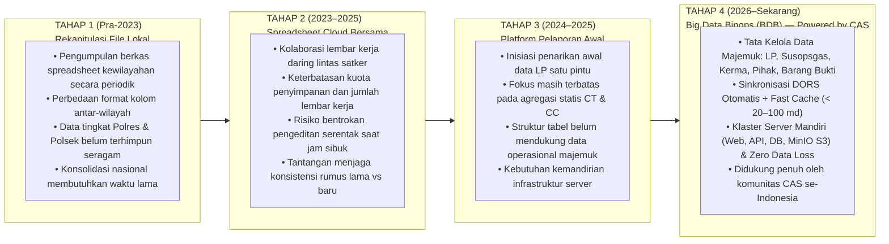
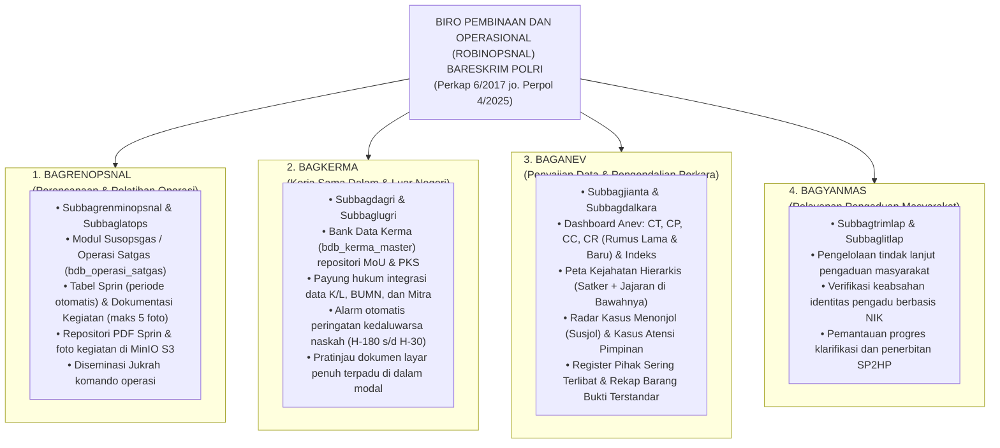
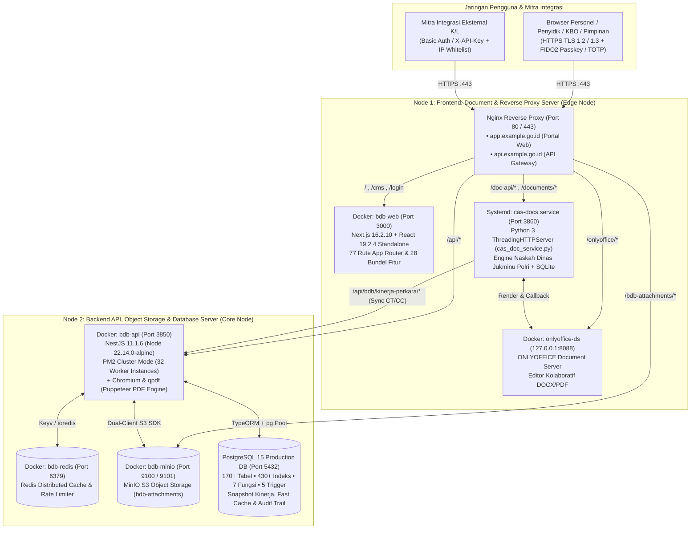

<div align="center">


# 🦅 BIG DATA BINOPS (BDB)
### *Powered by CAS (Community Anggota Serse)*
**Platform Tata Kelola Data Operasional Majemuk, Rekonsiliasi DORS 4-Tingkat & Analitik Penegakan Hukum Berkecepatan Tinggi (< 20–100 md)**  
*Biro Pembinaan dan Operasional (Robinopsnal) — Badan Reserse Kriminal (Bareskrim) Polri*

<p align="center">
  <a href="README.md"></a>
  <a href="README.id.md"></a>
</p>

<p align="center">
  <a href="https://github.com/omeko42"></a>
  <a href="https://www.linkedin.com/in/omeko42/"></a>
  
  
  
  
</p>

<p align="center">
  
  
  
  
  
  
  
</p>

---

[**1. Identitas & Visi**](#-1-identitas--visi-platform-bdb--cas) •
[**2. Evolusi 4 Tahap**](#-2-evolusi-4-tahap--capaian-rekonsiliasi) •
[**3. SOTK & 4 Bagian Robinopsnal**](#-3-keselarasan-sotk-perpol-42025--4-bagian-inti-robinopsnal) •
[**4. Arsitektur Multi-Node**](#-4-arsitektur-produksi-multi-node) •
[**5. Fitur Utama v2.6**](#-5-fitur-unggul-platform-rilis-v26) •
[**6. Otomatisasi Dokumen & Keamanan**](#-6-mesin-dokumen-jukminu--keamanan-zero-trust) •
[**7. Struktur Repositori & Instalasi**](#-7-struktur-repositori--panduan-instalasi)

</div>

---

## 🏛️ 1. Identitas & Visi Platform: BDB & CAS

**Big Data Binops (BDB)** adalah platform tata kelola data operasional dan analitik penegakan hukum yang dirancang untuk **Biro Pembinaan dan Operasional (Robinopsnal) Bareskrim Polri**, menghubungkan proses pengendalian perkara dari tingkat **Mabes Polri**, **36 Polda**, **Polres**, hingga **Polsek** di seluruh Indonesia.

Platform ini tumbuh bersama ekosistem **CAS (*Community Anggota Serse*)**:

| Pilar | Makna & Peran Operasional |
| :--- | :--- |
| **📊 BDB (*Big Data Binops*)** | Platform teknologi generasi ke-4 untuk mengelola data operasional majemuk kepolisian: **Laporan Polisi (LP)**, **Kinerja Penyidikan (CT, CP, CC, CR, Indeks Kinerja)**, **Susopsgas (Operasi Kepolisian & Satgas)**, **Kasus Menonjol & Atensi**, **Bank Data Kerja Sama (MoU/PKS)**, **Register Pihak Terlibat & DPO**, serta **Register Barang Bukti**. |
| **🤝 CAS (*Community Anggota Serse*)** | Komunitas operasional aktif yang mempertemukan penyidik, operator, Kanit Reskrim Polsek, dan **Kaur Binops (KBO)** Satreskrim/Ditreskrim se-Indonesia melalui kanal komunikasi taktis **SHARESE** untuk menjaga kualitas data dan mempercepat koordinasi lintas wilayah. |

### Filosofi Rekayasa Bagi Penyidik Lapangan
1. **Bebas Beban Dobel Input (*Single Source of Truth*)**: Ketika penyidik telah menginput Laporan Polisi pada sistem hulu (**DORS Stamaops Polri**), **BDB** menarik, membersihkan, dan memetakan datanya secara otomatis untuk kebutuhan analisis dan evaluasi (Anev) pimpinan.
2. **Proteksi Provenans Data Hulu (`Edit-Only / No-Delete`)**: Seluruh record LP, Tindak Pidana, Pihak Terlibat, dan Barang Bukti yang bersumber dari **DORS** dilindungi secara ketat agar tidak dapat dihapus di hilir, namun tetap dapat dilengkapi atribut pendukungnya (seperti satuan barang bukti atau progres dokumen penyidikan).
3. **Deteksi Hambatan Penyidikan & Asistensi KBO**: Sistem memantau masa penanganan perkara sesuai **SOP Perkap 6/2019** sehingga KBO dapat melakukan pembinaan secara tepat sasaran.

---

## 📈 2. Evolusi 4 Tahap & Capaian Rekonsiliasi



### Keunggulan Rekonsiliasi & Ketepatan Analitik
- **Rekonsiliasi Lintas Tingkat Kewilayahan**: Mesin rekonsiliasi multi-sumber (`bdb_dors_raw_lp` ↔ `bdb_laporan_polisi` ↔ `bdb_lp_pelimpahan`) menyelaraskan penempatan satker dan mengisolasi LP yang memerlukan pemetaan secara presisi.
- **Pelacakan Subjek Berulang & DPO Lintas Wilayah**: Menghubungkan nomor LP, indeks identitas (`bdb_pihak_terlibat_ranking_snapshot`), dan status DPO (`bdb_dpo`) untuk mendeteksi pelaku atau korporasi yang beraksi di lebih dari satu wilayah Polda.
- **Konsistensi Taksonomi Kejahatan & Sub-Tipid**: Menstandarkan kamus **Kelompok Kejahatan** (`KRIMUM`, `KRIMSUS`, `NARKOBA`, `PPA-PPO`, `SIBER`) dan **Sub-Kelompok Tipid** (`TIPIDUM`, `TIPIDEKSUS`, `TIPIDKOR`, `TIPIDTER`, `TIPIDNARKOBA`, `TIPIDPPA-PPO`, `TIPIDSIBER`) beserta singkatan satuan fungsi (`DITKRIMUM`, `DITKRIMSUS`, `DITNARKOBA`, `DITPPA-PPO`, `DITSIBER`, `SATRESKRIM`).

---

## ⚖️ 3. Keselarasan SOTK (`Perpol 4/2025`) & 4 Bagian Inti Robinopsnal

### 3.1. Integrasi Penuh Empat Bagian Robinopsnal Bareskrim Polri



### 3.2. Pemisahan Tegas Korps Reserse (`INTERNAL_RESERSE`) vs Non-Reserse (`EKSTERNAL_RESERSE`)
Melalui `bdb_satker` dan SQL View `bdb_satker_taxonomy_r11`, sistem memisahkan secara tegas rantai komando Reserse dari fungsi kepolisian lainnya agar perhitungan kinerja penyidikan tetap murni:

| Tingkat Kewilayahan | Unsur Korps Reserse (`INTERNAL_RESERSE` — Masuk Kinerja Reserse) | Unsur Non-Reserse (`EKSTERNAL_RESERSE` — Dipisahkan Kamarnya) |
| :--- | :--- | :--- |
| **Mabes Polri** | **Bareskrim Polri** (Robinopsnal, Rorenmin/Bagtahti, Rowassidik, Rokorwas PPNS, **6 Direktorat Teknis**: *Dittipidum, Dittipideksus, Dittipidter, Dittipidnarkoba, Dittipidsiber, Dittipid PPA-PPO*, **3 Pusat**: *Puslabfor, Pusiknas, Pusinafis*, serta **Satresmob**) | **Baharkam** (*Korpolairud/Ditpolairud, Sabhara, Binmas*), **Korlantas**, **Baintelkam**, **Kortastipidkor**, **Densus 88 AT** |
| **Polda (36 Polda)** | **5 Direktorat Reserse** (`DITKRIMUM`, `DITKRIMSUS`, `DITNARKOBA`, `DITSIBER`, dan `DITPPA-PPO`) | *Ditpolairud, Ditsamapta, Ditlantas, Ditbinmas, Ditpamobvit, Ditintelkam* |
| **Polres** | **Satreskrim, Satresnarkoba, dan Satres PPA-PPO** (*satker pemekaran sesuai Perpol 4/2025*, masing-masing dikendalikan oleh **KBO**) | *Satpolairud, Satsamapta, Satlantas, Satbinmas, Satintelkam* |
| **Polsek** | **Unit Reskrim Polsek** (*terintegrasi satu kesatuan cakupan dengan induk Polsek*) | *Unit Lantas, Unit Samapta/Sabhara, Unit Binmas, Unit Intelkam* |

---

## 🏗️ 4. Arsitektur Produksi Multi-Node



---

## 🚀 5. Fitur Unggul Platform (Rilis v2.6)

### 5.1. Analitik Cepat (< 20–100 md), Hover Flyout & Peta Kejahatan Hierarkis
- **Materialized Snapshot & Fast Cache**: Tabel `bdb_kinerja_perkara_snapshot`, `bdb_anev_dashboard_snapshot`, dan `bdb_pihak_terlibat_fast_cache` memangkas waktu muat **Ringkasan Dashboard**, **Kinerja Perkara**, **Staging DORS**, dan perpindahan tab peran **Pihak Terlibat** (*Tersangka, Saksi, Korban, Terlapor*) menjadi **`< 20–100 milidetik`**.
- **Hover Flyout pada 10 Jenis Kejahatan Tertinggi**: Mengarahkan kursor pada setiap baris di **10 Kejahatan Tertinggi** pada Dashboard langsung menampilkan *flyout* rincian kontribusi Satker tertinggi beserta persentasenya (seragam dengan perilaku *10 Satker CT/CC Tertinggi*).
- **Peta Kejahatan Hierarkis (`Satker + Jajaran di Bawahnya`)**: Memilih suatu Satker pada **Peta Kejahatan (`/cms/dashboard/peta-kejahatan`)** secara otomatis mengagregasikan data Satker induk beserta seluruh jajaran di bawahnya (konsisten dengan perilaku filter pada *Kinerja Perkara*).
- **Menu Sidebar Coserse (`@cosersebot`)**: Menyiapkan menu *sidebar* **Coserse** (dengan label *Segera*) dan entri bot `@cosersebot` pada obrolan cepat sebagai kesiapan integrasi asisten AI masa depan.

### 5.2. Standarisasi Daftar LP, Register Pihak Terlibat & Barang Bukti
- **Daftar Laporan Polisi (`/cms/laporan-polisi`)**:
  - Kolom **NO. LAPORAN** melakukan *wrap text* hingga 2 baris sebelum menampilkan elipsis (`...`) bila melampaui lebar kolom.
  - Kolom **SATKER PENANGANAN** menggunakan kamus `nama_singkat` resmi (`SATRESKRIM RES METRO JAKUT`, `DITKRIMUM`, dll.).
  - Kolom **DUGAAN TINDAK PIDANA** menampilkan 1 ikon palu di baris pertama (jenis kejahatan), diikuti baris kedua untuk daftar pasal.
- **Register Pihak Terlibat & Pihak Sering Terlibat**:
  - Label sumber data diseragamkan menjadi **`DORS`** (menggantikan istilah *Terpusat* / *Terintegrasi*).
  - Kategori jabatan korporasi menggunakan istilah **`Direktur Utama`**, dengan desain kontainer kartu dan lencana berbentuk **persegi panjang membulat tegas (*rounded rectangle* `8px–10px`)** serta batas tampilan baris tabel maksimal 2 baris per sel.
- **Register Barang Bukti (`/cms/laporan/rekap-barang-bukti`)**:
  - Menggabungkan kolom menjadi **JENIS & NAMA / DETAIL BARANG** (Baris 1: Kategori Induk Barang Bukti dengan elipsis otomatis; Baris 2: Nama/Detail Barang dengan elipsis otomatis).
  - Mengelompokkan barang bukti ke dalam **16 kategori induk standar nasional** (*Alat Penerangan, Hewan & Ternak, Kendaraan Bermotor, Alat Komunikasi & Elektronik, Senjata & Amunisi, Narkotika & Obat Terlarang, Uang & Instrumen Keuangan, Dokumen & Surat, Bahan Bakar & Energi, Logam Mulia & Perhiasan, Pakaian & Tekstil, Peralatan & Mesin, Bahan Kimia & Berbahaya, Hasil Hutan & Kayu, Pangan & Hasil Pertanian, Barang Bukti Lainnya*).
  - Memisahkan input **Jumlah (Numerik)** dan **Satuan (Dropdown Standar Indonesia: `Buah`, `Unit`, `Bilah`, `Butir`, ` Batang`, `Lembar`, `Berkas`, `Pasang`, `Kotak`, `Bungkus`, `Botol`, `Karung`, `Kg`, `Gram`, `Liter`, `Meter`, `Rupiah`, dll.)**. Khusus barang bukti dari DORS, operator dapat mengedit satuan barang untuk keperluan penghitungan tanpa menghapus data asli DORS.

### 5.3. Susopsgas, Kasus Menonjol, Portal Integrasi & Tata Kelola Pengguna
- **Susopsgas & Kasus Menonjol (`/cms/laporan/kasus-menonjol`)**:
  - Header tabel seragam dengan kolom **LP & Satker yg menangani** dan **Lampiran Dokumentasi**, serta dropdown penyelenggara berbasis kamus **Sub-Kelompok Tipid**.
  - Modul lampiran terbagi menjadi 2 tabel terstruktur: **(A) Tabel Surat Perintah (Sprin)** dalam 1 baris (*Nomor, Periode Mulai–Berakhir yang otomatis mengisi masa operasi, Catatan, dan Upload File*) serta **(B) Tabel Dokumentasi Kegiatan** (*Nama Giat, Tanggal Giat, Catatan, dan Upload maksimal 5 foto*).
- **Portal Integrasi Masuk & Staging (`/cms/integrasi/masuk-penarikan` & `/cms/integrasi/staging`)**:
  - Menampilkan daftar portal integrasi masuk dalam bentuk tabel terkelola (klien pertama: **`DORS — Stamaops Polri`**), dilengkapi tombol switch aktif/nonaktif dengan dialog konfirmasi serta modal **Kelola & Log** permanen untuk memudahkan mitigasi gangguan.
- **Skor Keaktifan Kombinasi & Role `sharese` / `testing`**:
  - **Skor Keaktifan Pengguna (`0–100pt`)** dihitung dari kombinasi **frekuensi hari login dalam 30 hari terakhir (maks 50pt)** dan **rata-rata durasi sesi login harian (maks 50pt)**.
  - Akun personel yang belum pernah aktif dialihkan ke role **`sharese`**, sedangkan role **`testing`** (*Vendor / Mitra*) memiliki akses lihat (*Read-Only*) ke seluruh menu tanpa izin mengubah data.
- **SHARESE `@username` Autocomplete, Multi-SMTP & Lapor Bug**:
  - Mengetik `@` pada **Sharese Feed** menampilkan daftar saran `@username` secara langsung; kartu variabel pada **Pengaturan Email (`/cms/pengaturan/email`)** ditempatkan rapi di bawah kartu SMTP Polri; dan tombol mengambang **Lapor Bug & Kendala Sistem** tersedia untuk pelaporan kendala teknis.

---

## 📄 6. Mesin Dokumen Jukminu & Keamanan Zero-Trust

### 6.1. Otomatisasi Naskah Dinas Jukminu Polri (`cas_doc_service.py` + ONLYOFFICE)
1. **Mesin 13 Lembar Perkap Polri WYSIWYG (`anev.service.ts`)**: Menghasilkan lembar evaluasi CT/CC lengkap dengan pratinjau langsung di peramban dan ekspor PDF/XLSX melalui *worker threads*.
2. **Layanan Mikro Python Jukminu Polri (`cas_doc_service.py` di port `3860`) + ONLYOFFICE (`8088`)**:
   - Menghasilkan dokumen `.docx` dan `.pdf` berformat **`CAS-{hash_8}-{DDMMYYYY}.docx`**.
   - Menyusun **Kop Surat Bertingkat** sesuai Satker dan satuan fungsi, blok tanda tangan **`a.n. Pimpinan`**, *watermark* identitas personel, serta sinkronisasi angka CT/CC otomatis.

### 6.2. Keamanan Zero-Trust & Kepatuhan Sanitasi
- **Passkey Perangkat Keras FIDO2 / WebAuthn (`@simplewebauthn/server`)**, **TOTP 2FA (RFC 6238)**, **PIN 6 Digit**, **OTP Email Multi-SMTP**, dan **Captcha Hybrid PoW + SVG**.
- **Enkripsi ID Buram (`id-cipher.util.ts`)** berbasis AES-GCM pada URL eksternal serta pencatatan permanen di `bdb_audit_log`.
- **Kebijakan Tanpa Rahasia (*Zero-Secret Repository*)**: Repositori ini **0% memuat data perkara nyata, PII masyarakat, kredensial produksi, maupun alamat IP internal**.

---

## 📂 7. Struktur Repositori & Panduan Instalasi

```text
big-data-binops/
├── README.md                                  # Dokumentasi Utama (Bahasa Inggris)
├── README.id.md                               # Dokumentasi Utama (Bahasa Indonesia)
├── ARCHITECTURE.md                            # Catatan Keputusan Arsitektur (ADR-001 s/d ADR-005)
├── CHANGELOG.md                               # Riwayat Rilis Platform (v1.0 s/d v2.6.0)
├── CONTRIBUTING.md                            # Pedoman Kontribusi & Pelaporan Lapangan CAS
├── SECURITY.md                                # Kebijakan Keamanan Zero-Secret & Kepatuhan UU PDP
├── LICENSE.md                                 # Lisensi Kedinasan, NDA, SLA & Tata Kelola Keamanan
├── CITATION.cff                               # Metadata Sitasi Ilmiah & Portofolio (v2.6.0)
├── backend/                                   # Server API Klaster NestJS 11 (bdb-api :3850)
│   ├── src/app_core/                          # Auth, Passkey WebAuthn, RBAC, Perangkat, Multi-SMTP
│   └── src/bdb/                               # 26 Sub-Modul Inti Operasional BDB
├── frontend/                                  # Portal Web Next.js 16.2.10 + React 19.2.4 (:3000)
│   ├── src/modules/                           # 28 Bundel Fitur Operasional (Dashboard, LP, Sharese, dll.)
│   ├── services/cas-doc-service/              # Layanan Mikro Python 3 Jukminu & ONLYOFFICE (:3860)
│   └── FRONTEND_ROUTES_AND_MODULES.md         # Inventaris 77 Rute & 28 Bundel Fitur Frontend
├── database/                                  # Arsitektur Basis Data PostgreSQL 15
│   ├── schema/000_live_production_schema.sql  # Skema DDL Lengkap (Tanpa Data Perkara/PII)
│   ├── schema/DATABASE_INVENTORY.md           # Dokumentasi 12 Domain Fungsional Basis Data
│   └── migrations/                            # Berkas Migrasi SQL Berurutan
└── docs/                                      # Dokumentasi Strategis, Infrastruktur & Integrasi API
    ├── STRATEGIC_GOVERNANCE_AND_EVOLUTION.md  # Evolusi 4 Tahap, SOTK Perpol 4/2025 & 6 Pilar
    ├── SERVER_ARCHITECTURE_AND_INVENTORY.md   # Topologi Multi-Node & Inventaris Layanan
    ├── API_INTEGRATION_GUIDE.md               # Spesifikasi Teknis Portal Integrasi Keluar
    ├── GENAI_INTEGRATION_SPEC.md              # Spesifikasi Pipeline RAG / Generative AI
    └── infrastructure/                        # Template Docker Compose, Nginx, dan Crontab (.example)
```

### Langkah Cepat Menjalankan Lingkungan Pengembangan
1. **Persiapan Basis Data PostgreSQL 15**:
   ```bash
   psql -U postgres -c "CREATE DATABASE bdb_production;"
   psql -U postgres -d bdb_production -f database/schema/000_live_production_schema.sql
   ```
2. **Menjalankan Backend API (`bdb-api` — Port `3850`)**:
   ```bash
   cd backend
   cp .env.example .env
   npm install
   npm run build
   pm2 start ecosystem.config.js
   ```
3. **Menjalankan Layanan Dokumen Jukminu (`cas-doc-service` — Port `3860`)**:
   ```bash
   cd frontend/services/cas-doc-service
   python3 cas_doc_service.py
   ```
4. **Menjalankan Portal Frontend (`bdb-web` — Port `3000`)**:
   ```bash
   cd frontend
   cp .env.example .env
   npm install
   node server.js
   ```

---

<div align="center">
  <sub>Dirancang dan dikembangkan oleh <b>Eko Agung (<a href="https://github.com/omeko42">@omeko42</a>)</b> bersama <b>Tim Pokja Bareskrim Polri</b> &amp; <b>CAS (Community Anggota Serse)</b>.<br/>© 2024–2026 Biro Pembinaan dan Operasional (Robinopsnal) Bareskrim Polri.</sub>
</div>
