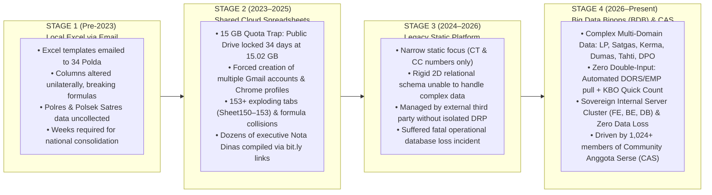
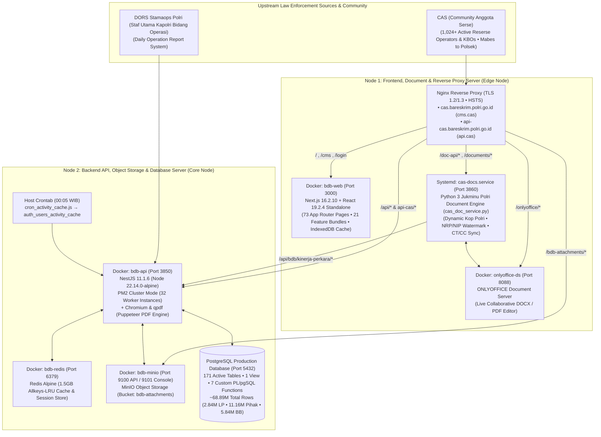

# Big Data Binops (BDB) — Powered by CAS (*Community Anggota Serse*)

[%20v2.5-1E40AF.svg?style=flat-square)](#)
[-25D366.svg?style=flat-square&logo=whatsapp&logoColor=white)](#-the-evolution-story-from-data-analyst-to-full-stack-system-architect)
[](https://www.typescriptlang.org/)
[](https://nestjs.com/)
[](https://nextjs.org/)
[%20%7C%20Redis-336791.svg?style=flat-square&logo=postgresql&logoColor=white)](https://www.postgresql.org/)
[](#3-13-sheet-official-perkap--jukminu-polri-document-engine--onlyoffice-integration)
[](#4-fido2--webauthn-hardware-passkey--zero-trust-security-suite)
[%20%26%20Portfolio-B91C1C.svg?style=flat-square)](LICENSE)

**Big Data Binops (BDB)** is an enterprise-grade operational data governance, multi-source case lifecycle management, and law enforcement analytics platform engineered for **Biro Pembinaan dan Operasional (Robinopsnal) Bareskrim Polri**.

Born out of **CAS (*Community Anggota Serse*)** — a grassroots operational community of **1,024+ active criminal investigation personnel, operators, Kanit Reskrim, and Kaur Binops (KBO)** across Indonesia — **Big Data Binops (BDB)** unifies **~68.89 million live production records** (**2.84+ million Police Reports / LP**, **11.16+ million involved parties**, **5.84+ million evidence items**, and **5.46+ million forensic audit logs**) across all 4 territorial tiers (**Mabes Polri $\to$ 36 Polda $\to$ 508+ Polres $\to$ 4,900+ Polsek**).

---

## 💡 The Evolution Story: From Data Analyst to Full-Stack System Architect

This platform was not built from abstract theoretical specifications — it was engineered from the ground up by a **Data Analyst turned Full-Stack Engineer** who lived through every stage of operational data fragility at Robinopsnal Bareskrim Polri:



### Why **CAS (*Community Anggota Serse*)** $\to$ **Big Data Binops (BDB)** Matters
1. **Bottom-Up Operational Adoption (`CAS — Community Anggota Serse`)**: Rather than forcing a top-down tool that burdens field investigators with double data entry (*beban dobel input*), **CAS** connected **1,024+ active Reserse personnel** in a direct real-time community loop (WhatsApp & internal **SHARESE** tactical forum). Field operators report jurisdiction edge cases, *pemekaran satker* anomalies, and workflow bottlenecks directly, which are resolved in real time within **BDB**.
2. **Full SOTK Alignment (`Perkap 6/2017 jo. Perpol 4/2025`)**: Unifies the core workflows of all **4 Bagian of Robinopsnal Bareskrim Polri**:
   - **Bagrenopsnal (*Perencanaan & Pelatihan Operasi*)**: Active Police Operations & Task Forces (`bdb_operasi_satgas` — 12 active Satgas), LP operation tagging (`operasi_satgas_id`), MinIO S3 *Sprin & Renops* PDF repository, and encrypted operational *Jukrah*.
   - **Bagkerma (*Kerja Sama Dalam & Luar Negeri*)**: Domestic & international cooperation repository (`bdb_kerma_master` MoU/PKS with Ministries, BUMN, Banking, and foreign agencies) with automated **H-180 to H-30** expiration alarms.
   - **Baganev (*Penyajian Data & Pengendalian Perkara*)**: Sub-100ms CT/CP/CC/CR & Performance Index engine, **Perkap 6/2019 SLA Engine** (*Mudah 30d* to *Sangat Sulit 120d*), *Radar Kasus Menonjol (Susjol)* & *Kasus Atensi*, and **Cross-Province Syndicate Intelligence** (`is_lintas_wilayah` — **5,828 multi-Polda subjects**).
   - **Bagyanmas (*Pelayanan Pengaduan Masyarakat*)**: Public non-LP complaint (*Dumas*) intake with official **NIK verification**, self-tracking QR-Code, and transparent **SP2HP-Dumas** (*Quick Win Presisi*).
3. **Proven High-Speed Mathematical Reconciliation (2026 Operational Benchmarks)**:
   - **Zero-Discrepancy Multi-Source Audit**: Resolved an urgent `8 LP` cross-source delta (`1,728` raw DORS vs `1,720` Directorate recap) in minutes during executive diplomatic preparation by isolating regional files in physical transit.
   - **100% Verified 36-Polda Mathematical Audit**: Verified `270,059 CT` nationally (`269,436 CT` across 36 Polda + `623 CT` Bareskrim, including exact consolidation of `Ditreskrimum = Tipidum 199,121 + Tipid PPA-PPO 21,024 = 220,145`).

---

## 🏛️ Real Multi-Node Production Architecture



> 📖 **Deep-Dive Documentation & Blueprints**:
> - [**`docs/STRATEGIC_GOVERNANCE_AND_EVOLUTION.md`**](docs/STRATEGIC_GOVERNANCE_AND_EVOLUTION.md) — Executive Strategic Brief, 4-Stage Evolution, SOTK Perpol 4/2025 Matrix & 6-Pillar Target Blueprint
> - [**`ARCHITECTURE.md`**](ARCHITECTURE.md) — System Architecture & Engineering Decision Records (ADRs 001–005)
> - [**`docs/SERVER_ARCHITECTURE_AND_INVENTORY.md`**](docs/SERVER_ARCHITECTURE_AND_INVENTORY.md) — Real Dual-Node Server Topology, Containers, Ports & 26 NestJS Submodules
> - [**`database/schema/DATABASE_INVENTORY.md`**](database/schema/DATABASE_INVENTORY.md) — 171 Active Production Tables & ~68.89M Row Inventory Across 12 Domains
> - [**`frontend/FRONTEND_ROUTES_AND_MODULES.md`**](frontend/FRONTEND_ROUTES_AND_MODULES.md) — Complete 73 Next.js App Router Pages & 21 Feature Bundles Mapping
> - [**`CHANGELOG.md`**](CHANGELOG.md) — Platform Release History (Phase 1–3 to BDB v2.5)

---

## 🗄️ 4 High-Availability Database Clusters (PostgreSQL Production)

| Functional Cluster | Core Tables & Scale | Key Engineering Implementation |
| :--- | :--- | :--- |
| **Cluster 1: DORS Ingestion & Core LP** | `bdb_dors_raw_lp` (**2.85M**), `bdb_laporan_polisi` (**2.84M**), `bdb_satker` (**14,217**), `bdb_dors_lp_terlibat` (**11.16M**), `bdb_dors_lp_barang_bukti` (**5.84M**) | Decoupled JSONB staging via `raw_lp_id`; `REGEXP_REPLACE` sanitization of invisible NBSP (`chr(160)`) on `kode_pusiknas`; 11 KUHAP lifecycle statuses (strict doctrine: **P-21 remains CT workload until physical Tahap II handover**). |
| **Cluster 2: Tactical Operations & MinIO S3** | `bdb_kasus_menonjol` (**699+**), `bdb_kasus_atensi`, `bdb_operasi_satgas` (**12 Satgas**), `bdb_kerma_master`, `bdb_lp_pelimpahan` (**2,590+**) | Multi-LP bridge for prominent/attention cases; MinIO S3 **Dual-Client Pattern** (Port `9100`/`9101`) eliminating PostgreSQL blob bloat; **Placement Guard** locking 1-level transfer mutations. |
| **Cluster 3: Performance Analytics, SLA & Syndicate Engine** | `bdb_kinerja_perkara_snapshot` (**2.11M**), `bdb_anev_rekap_snapshot` (**508K**), `bdb_pihak_terlibat_ranking_snapshot` (**151K**) | Pre-computed materialized snapshots cutting national aggregation queries from **$>10\text{ s}$ to $<100\text{ ms}$**; **Perkap 6/2019 SLA Engine** (`30d`–`120d`); cross-province syndicate scoring (**5,828 multi-Polda subjects**). |
| **Cluster 4: SHARESE Tactical Forum & Forensic Audit** | `bdb_social_posts`, `bdb_jukrah`, `bdb_jukrah_view`, `bdb_audit_log` (**5.46M+ live logs**) | Case-linked tactical forum (`case_lp_ids`, `#ModusOperandi`, `#DPO`, `#Sindikat`), pinned leadership *Jukrah*, and immutable JSONB forensic audit logging (`User ID, IP, Action, Entity, Meta`). |

---

## 🚀 Key Production Capabilities

### 1. 4-Tier DORS Ingestion & Strict Reserse Command-Chain Isolation
- **Sentralitas Binops Reserse (`Mabes → Polda → Polres → Polsek`)**: Strictly separates the Reserse command chain (`INTERNAL_RESERSE`: Bareskrim 6 Directorates + *Satresmob*, 5 Polda Ditres led by *Kabagbinopsnal*, Polres *Satreskrim / Satresnarkoba / Satres PPA-PPO* led by *KBO*, and *Unit Reskrim Polsek*) from non-Reserse functions (`EKSTERNAL_RESERSE`: *Baharkam, Polairud, Sabhara/Samapta, Lantas, Intelkam, Kortastipidkor, Densus 88 AT*).
- **Role-Scoped Monitoring Plan (`LpMonitoringAccessService`)**: Dynamically computes hierarchical read/write/transfer permissions across territorial parent-child trees (including unified `Polsek` $\leftrightarrow$ `Unit Reskrim Polsek` scopes and `Polda Directorate` $\to$ `Polres Satreskrim/Satresnarkoba/Satresppa` oversight).

### 2. Crime Clearance (CT / CP / CC / CR) & Multi-Directorate Taxonomy Engine
- **End-to-End Case Lifecycle Tracking**: Tracks criminal cases from initial report (**LP / Belum Update**) through **Penyelidikan (Lidik)**, **Penyidikan (Sidik)**, **SPDP**, **Tahap I**, **P19**, **P21**, to final resolution via **Tahap II**, **Henti Lidik (SP2Lid)**, **Henti Sidik (SP3 / Restorative Justice)**, and **PERMA Tipiring**.
- **Versioned Crime Group Taxonomy**: Maps 780+ statutory crime classifications (`cm_jenis_kejahatan` & `bdb_kinerja_crime_group_mapping`) into specialized investigation domains (**Tipidum, Tipideksus, Tipidkor, Tipidter, Tipidsiber, PPA-PPO, and Narkoba**) while isolating non-criminal/traffic offenses (**Korlantas / Satlantas**).

### 3. 13-Sheet Official Perkap & Jukminu Polri Document Engine + ONLYOFFICE Integration
- **Built-in 13-Sheet Official Perkap Polri WYSIWYG Suite (`anev-ctcc-onlyoffice.bundle.js` + `anev.service.ts`)**: Generates all **13 Official Perkap Polri Periodic Evaluation Sheets (*Lembar Anev Periodik*)** with live telemetry binding.
- **Dedicated Python Jukminu Polri & ONLYOFFICE Microservice (`cas_doc_service.py` on Port `3860` + `onlyoffice-ds` on Port `8088`)**: Generates standardized `.docx` and `.pdf` executive reports (`CAS-{hash_8}-{DDMMYYYY}.docx`) featuring dynamic Satker/Fungsi **Kop Surat**, dynamic `a.n. Pimpinan` signature blocks, per-user **NRP/NIP watermarks**, centered page numbering from Page 2, and Jukminu *Catchwords* (*Kata Penghubung*).

### 4. FIDO2 / WebAuthn Hardware Passkey & Zero-Trust Security Suite
- **Hardware-Bound Biometric Passkeys (`FIDO2 / WebAuthn`)**: Passwordless cryptographic authentication (`@simplewebauthn/server` + `auth_passkeys` / `auth_passkey_challenges`) bound to device hardware (`Windows Hello TPM`, `Apple Touch ID / Face ID Secure Enclave`, `Android Keystore`) with mandatory user verification (`userVerification: 'required'`).
- **Multi-Factor Verification & Device Governance**: Supports **TOTP 2FA (Google Authenticator)**, **6-Digit Security PIN**, **Proof-of-Work (PoW) + SVG Captcha**, and **Email OTP**, paired with self-service **Trusted Device Audit & Revocation (`Otorisasi Cabut Akses Gawai` on `auth_devices`)**.

### 5. Offline-First IndexedDB & Managed External API Gateway
- **Zero-Latency Period Switching**: Preloads **13 temporal snapshot partitions (Full Year + 12 Monthly Partitions)** into local IndexedDB (`bdb_offline_db`) with automatic form-draft persistence and offline mutation outbox resync.
- **Managed External API & GenAI RAG Gateway**: 9 granular authorization scopes (`laporan_polisi.read`, `klasifikasi`, `status`, `penanganan`, `tkp`, `kronologi`, `kerugian`, `pihak_terlibat`, `barang_bukti`), sliding-window rate limiting, IP whitelisting, Puppeteer + `qpdf` encrypted API documentation generator, and AES-GCM opaque ID ciphers (`id-cipher.util.ts`).

---

## 📂 Complete Repository Structure (Real Server Mirror — 497 Tracked Files)

```text
├── backend/                                    # NestJS 11 Backend Server (bdb-api :3850, PM2 32-Worker Cluster)
│   ├── Dockerfile.bdb & ecosystem.config.js    # Alpine Node 22.14 + Chromium + qpdf + PM2 32-instance cluster config
│   ├── cron_activity_cache.js                  # Daily 00:05 WIB personnel activity scoring worker
│   ├── package.json & tsconfig.json            # NestJS 11 dependencies & TypeScript build config
│   └── src/
│       ├── main.ts & app.module.ts             # Application bootstrap & root module orchestration
│       ├── app_core/                           # Core Framework Layer (Auth, Passkey, RBAC, TypeORM, Redis, Swagger)
│       ├── bdb/                                # Big Data Binops Core Engine (All 26 Operational Submodules)
│       │   ├── anev/                           # ANEV LP, ANEV CT/CC & 13-Sheet Perkap Polri Lampiran Engine
│       │   ├── audit/                          # Global audit trail interceptor & query service (5.46M+ logs)
│       │   ├── barang-bukti/                   # National evidence registry & summary snapshot service
│       │   ├── common/                         # Scope plan, PostgreSQL advisory job queue & Snapshot Orchestrator
│       │   ├── dors/                           # DORS Stamaops Polri bidirectional sync scheduler & raw mirror store
│       │   ├── dpo/                            # Daftar Pencarian Orang (DPO) lifecycle & archive service
│       │   ├── integration-client/             # External API client management & encrypted PDF doc generator
│       │   ├── jukrah/                         # Leadership directives (Jukrah & Atensi) & read-receipt tracking
│       │   ├── kasus-atensi/ & kasus-menonjol/ # High-priority attention & prominent cases (Susjol/Susatensi)
│       │   ├── kerma/                          # Domestic/International cooperation (MoU/PKS) & MinIO S3 service
│       │   ├── kinerja-perkara/                # CT/CP/CC/CR/Indeks Snapshot Engine & PDF/XLSX Worker Threads
│       │   ├── laporan-polisi/                 # Core LP CRUD, 4-Tier placement, AES ID cipher & Master Data Gap
│       │   ├── load-test/                      # Internal Autocannon stress & load testing controller
│       │   ├── lp-pelimpahan/                  # Internal, External & Cross-Polda case transfer workflow
│       │   ├── master/ & menu-access/          # BDB Master reference & dynamic role-based menu matrix
│       │   ├── notifications/                  # SHARESE social feed, posts, comments, reactions & notifications
│       │   ├── operasi-satgas/ & panduan/      # Police operations (Satgas) & interactive user guide management
│       │   ├── pihak-terlibat/ & rekap-lp/     # National NIK/NRP/Corporate syndicate search & LP recapitulation
│       │   ├── satker/ & satker-eksternal/     # 4-Tier Satker tree (14,217 nodes) & external agencies (6,666 nodes)
│       │   └── system-setting/ & workflow/     # Runtime settings & investigation document workflow (Mindik–Tahap II)
│       ├── external/                           # Managed External REST API Gateway (/api/external/*)
│       └── bareskrim/, dashboard/, orgaisasi/  # Foundational entities, summary views & organizational hierarchy
├── frontend/                                   # Next.js 16.2.10 Portal & Document Microservice (Edge Node)
│   ├── package.json & server.js                # Next.js 16.2.10 standalone server (:3000) with Cache-Control guard
│   ├── FRONTEND_ROUTES_AND_MODULES.md          # Complete mapping of all 73 App Router pages & 21 feature bundles
│   ├── public/tools/Bersihkan-Cache-CAS.bat    # Client browser cache reset utility
│   ├── services/cas-doc-service/               # Python 3 Jukminu Polri & ONLYOFFICE Service (:3860)
│   └── src/
│       ├── app-routes-manifest.json            # Official Next.js App Router path manifest (73 routes)
│       ├── modules/                            # 21 Active Production Client Feature Bundles
│       └── styles/theme.modern.css             # Adaptive Light & Dark Mode Design System (--cas-* tokens)
├── database/                                   # PostgreSQL Production Schema & Migrations
│   ├── schema/
│   │   ├── 000_live_production_schema.sql      # Complete Live DDL (171 Tables, 7 PL/pgSQL Functions, 433 Indexes, 5 Triggers)
│   │   └── DATABASE_INVENTORY.md               # Domain-by-domain inventory of all 172 relations (~68.89M live rows)
│   └── migrations/                             # 90 Sequential SQL Migrations (000 through 089_passkey_webauthn.sql)
├── docs/                                       # Strategic Governance, Server Inventory & Sanitized Infra Blueprints
│   ├── STRATEGIC_GOVERNANCE_AND_EVOLUTION.md   # 4-Stage Evolution, SOTK Perpol 4/2025, 4 DB Clusters & 6-Pillar Blueprint
│   ├── SERVER_ARCHITECTURE_AND_INVENTORY.md    # Real Dual-Node Production Server Forensic Architecture
│   ├── API_INTEGRATION_GUIDE.md                # Managed External REST API Reference & Security Spec
│   ├── GENAI_INTEGRATION_SPEC.md               # LLM / RAG Downstream Ingestion Specification
│   └── infrastructure/                         # Sanitized Nginx, Docker Compose & Crontab production blueprints
├── ARCHITECTURE.md                             # Engineering Decision Records (ADRs 001–005)
├── CHANGELOG.md                                # Platform Evolution & Release History
├── CONTRIBUTING.md                             # Governance & Contribution Guidelines (Pokja Bareskrim & CAS)
├── CITATION.cff                                # Official Academic & Technical Citation Metadata
├── LICENSE                                     # Sovereign Institutional (Polri) & Architectural Portfolio License
├── SECURITY.md                                 # Security Architecture, Zero-Secret Policy & UU PDP Compliance
└── .env.example                                # Sanitized Root Environment Variable Template
```

---

## 🛠️ Technology Stack

| Layer | Technologies |
| :--- | :--- |
| **Backend API (`bdb-api`)** | NestJS 11.1.6, TypeScript 5.7, TypeORM 0.3.24, Node.js 22.14 (Alpine), PM2 Cluster (32 instances), `@simplewebauthn/server` (FIDO2), Puppeteer + `qpdf`, ExcelJS, `pdfmake` |
| **Frontend Portal (`bdb-web`)** | Next.js 16.2.10 (App Router, Standalone), React 19.2.4, PrimeReact 10.9.8, Chart.js 4.5.1, Lucide React 1.24.0, Axios 1.18.1, IndexedDB |
| **Document Engine (`cas-docs`)** | Python 3 `ThreadingHTTPServer` (`cas_doc_service.py`), ONLYOFFICE Document Server (`onlyoffice-ds`), SQLite metadata store |
| **Database & Cache** | PostgreSQL (171 active tables, 7 PL/pgSQL functions, 433 indexes, Advisory Locks), Redis (`redis:alpine`, `ioredis` / `@keyv/redis`) |
| **Object Storage & Infra** | MinIO S3 Object Storage (`bdb-attachments`), Nginx Reverse Proxy (TLS 1.2/1.3, HSTS), Docker Engine |

---

## 🔒 Security, Licensing & Governance

- **Sovereign Institutional & Portfolio License ([`LICENSE`](LICENSE))**: Engineered by **Eko Agung (`@omeko11`)** for official operational governance across **Robinopsnal Bareskrim Polri** and **CAS (*Community Anggota Serse*)**. Published strictly for software engineering portfolio evaluation and architectural reference (**All Rights Reserved — Commercial redistribution and institutional impersonation are strictly prohibited**).
- **Regulatory Compliance**: Engineered in strict accordance with **UU No. 27 Tahun 2022 tentang Perlindungan Data Pribadi (UU PDP)**, **Perkap 6/2017 jo. Perpol 4/2025**, and **Perkap 6/2019**.
- **Zero-Secret Version Control**: Every tracked file in this repository has been audited and sanitized to guarantee zero leaked JWT secrets, database passwords, MinIO keys, TLS private keys, or internal private IP addresses. See [`.env.example`](.env.example), [`backend/.env.bdb.example`](backend/.env.bdb.example), and [`SECURITY.md`](SECURITY.md) for deployment configuration guidelines.

---

## 👨‍💻 Creator & Full-Stack System Architect

- **Eko Agung** ([@omeko11](https://github.com/omeko11))  
  *Full-Stack Engineer & System Architect (Former Operational Data Analyst — Robinopsnal Bareskrim Polri)*  
  *Founder of **CAS (Community Anggota Serse)** & Lead Engineer of **Big Data Binops (BDB)***
