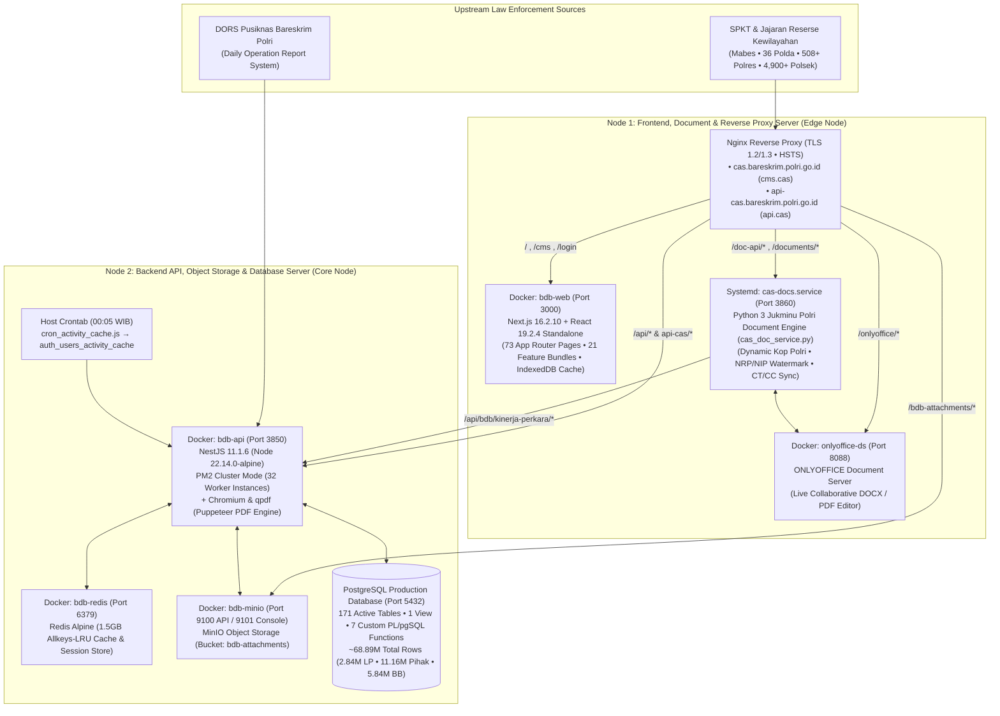

# Crime Analytic System (CAS) & Big Data Binops (BDB)

[](https://www.typescriptlang.org/)
[](https://nestjs.com/)
[](https://nextjs.org/)
[%20%7C%20Redis-336791.svg?style=flat-square&logo=postgresql&logoColor=white)](https://www.postgresql.org/)
[](#3-13-sheet-official-perkap--jukminu-polri-document-engine--onlyoffice-integration)
[](#4-fido2--webauthn-hardware-passkey--zero-trust-security-suite)
[](#security--governance)

Enterprise-grade criminal intelligence, operational case lifecycle management, and law enforcement analytics platform engineered for **Bareskrim Polri**. In production, the platform ingests, reconciles, standardizes, and analyzes over **2.84+ million nationwide Police Reports (*Laporan Polisi* / LP)**, **11.16+ million involved parties (*Pihak Terlibat*)**, and **5.84+ million evidence items (*Barang Bukti*)** (~**68.89 million total live database records**) across all 4 territorial tiers (**Mabes Polri $\to$ 36 Polda $\to$ 508+ Polres $\to$ 4,900+ Polsek**) and **6 Specialized Criminal Investigation Directorates** across Indonesia.

---

## 🏛️ Real Multi-Node Production Architecture



> 📖 For the complete forensic breakdown of containers, ports, reverse-proxy rules, NestJS modules, and database domains, see:
> - [**`docs/SERVER_ARCHITECTURE_AND_INVENTORY.md`**](docs/SERVER_ARCHITECTURE_AND_INVENTORY.md) — Real Multi-Node Server Topology & Component Inventory
> - [**`database/schema/DATABASE_INVENTORY.md`**](database/schema/DATABASE_INVENTORY.md) — 171 Active Production Tables & ~68.89M Row Inventory
> - [**`frontend/FRONTEND_ROUTES_AND_MODULES.md`**](frontend/FRONTEND_ROUTES_AND_MODULES.md) — Complete 73 Next.js App Router Pages & 21 Feature Bundles Mapping

---

## 🚀 Key Production Capabilities

### 1. 4-Tier DORS Ingestion & Hierarchical Jurisdiction Engine
- **High-Volume Bidirectional Reconciliation**: Continuously ingests raw operational records (`bdb_dors_raw_lp`, **2.85M+ rows**) from **DORS Pusiknas** into normalized relational tables (`bdb_laporan_polisi`, `bdb_dors_lp_terlibat` [**11.16M+ rows**], `bdb_dors_lp_barang_bukti` [**5.84M+ rows**], `bdb_lp_tindak_pidana_dors`, `bdb_dokumen`, `bdb_lp_pelimpahan`).
- **4-Tier Guard Verification (`Mabes → Polda → Polres → Polsek`)**: Resolves territorial ownership across **14,217 internal Satker nodes** (`bdb_satker`) and **6,666 external institution nodes** (`bdb_satker_eksternal`) using multi-signal ranking (`kode_pusiknas`, `kode_canonical`, `dors_kode`, `nama_satker_dors`, and `bdb_dors_satker_map`) with automated **Pemekaran Polres/Polsek** hierarchy reconciliation and inter-agency transfer (*Pelimpahan Internal & Eksternal*) tracking.
- **Role-Scoped Monitoring Plan (`LpMonitoringAccessService`)**: Dynamically computes hierarchical read/write/transfer permissions across territorial parent-child trees (including unified `Polsek` $\leftrightarrow$ `Unit Reskrim Polsek` scopes and `Polda Directorate` $\to$ `Polres Satreskrim/Satresnarkoba/Satresppa` oversight).

### 2. Crime Clearance (CT / CP / CC / CR) & Multi-Directorate Taxonomy Engine
- **End-to-End Case Lifecycle Tracking**: Tracks criminal cases from initial report (**LP / Belum Update**) through **Penyelidikan (Lidik)**, **Penyidikan (Sidik)**, **SPDP**, **Tahap I**, **P19**, **P21**, to final resolution via **Tahap II**, **Henti Lidik (SP2Lid)**, **Henti Sidik (SP3 / Restorative Justice)**, and **PERMA Tipiring**.
- **Versioned Crime Group Taxonomy**: Maps statutory crime classifications (`cm_jenis_kejahatan` & `bdb_kinerja_crime_group_mapping`) into specialized investigation domains (**Tipidum, Tipideksus, Tipidkor, Tipidter, Tipidsiber, PPA-PPO, and Narkoba**) while isolating non-criminal/traffic offenses (**Korlantas / Satlantas**) to prevent cross-domain metric distortion.
- **Non-Blocking Materialized Snapshots**: Background snapshot orchestrator (`snapshot-orchestrator.service.ts` + PostgreSQL Advisory Locks) maintaining `bdb_kinerja_perkara_snapshot` (**2.11M+ active rows**) and `bdb_anev_rekap_snapshot` (**508K+ rows**) for sub-second national and regional aggregations of **Crime Total (CT)**, **Crime Process (CP Aktual & Tunggakan)**, **Crime Clearance (CC Aktual & Tunggakan)**, **Clearance Rate (CR Rumus Lama & Baru)**, **Crime Risk**, **Crime Clock**, and **5-Level Composite Performance Index**.

### 3. 13-Sheet Official Perkap & Jukminu Polri Document Engine + ONLYOFFICE Integration
- **Dual Document Engine**:
  - **Built-in 13-Sheet Official Perkap Polri WYSIWYG Suite (`anev-ctcc-onlyoffice.bundle.js` + `anev.service.ts`)**: Generates all **13 Official Perkap Polri Periodic Evaluation Sheets (*Lembar Anev Periodik*)** with live telemetry binding.
  - **Dedicated Python Jukminu Polri & ONLYOFFICE Microservice (`cas_doc_service.py` on Port `3860` + `onlyoffice-ds` on Port `8088`)**: Generates standardized `.docx` and `.pdf` executive reports (`CAS-{hash_8}-{DDMMYYYY}.docx`) featuring dynamic Satker/Fungsi **Kop Surat**, dynamic `a.n. Pimpinan` signature blocks, per-user **NRP/NIP watermarks**, centered page numbering from Page 2, and Jukminu *Catchwords* (*Kata Penghubung*).

### 4. FIDO2 / WebAuthn Hardware Passkey & Zero-Trust Security Suite
- **Hardware-Bound Biometric Passkeys (`FIDO2 / WebAuthn`)**: Passwordless cryptographic authentication (`@simplewebauthn/server` + `auth_passkeys` / `auth_passkey_challenges`) bound to device hardware (`Windows Hello TPM`, `Apple Touch ID / Face ID Secure Enclave`, `Android Keystore`) with mandatory user verification (`userVerification: 'required'`).
- **Multi-Factor Verification & Device Governance**: Supports **TOTP 2FA (Google Authenticator)**, **6-Digit Security PIN**, **Proof-of-Work (PoW) + SVG Captcha**, and **Email OTP**, paired with self-service **Trusted Device Audit & Revocation (`Otorisasi Cabut Akses Gawai` on `auth_devices`)**.
- **Cross-Tab Instant Session Sync**: Real-time `BroadcastChannel` and `storage` event synchronization ensuring instant multi-tab logout and automatic local cache sanitization on account switch or superadmin impersonation.

### 5. Offline-First IndexedDB & 13-Period Global Snapshot Cache
- **Zero-Latency Period Switching**: Preloads **13 temporal snapshot partitions (Full Year + 12 Monthly Partitions)** into local IndexedDB (`bdb_offline_db`) for instant dashboard and report rendering.
- **Resilient Field Operations**: Automatic form-draft persistence (`bdbSaveDraft` / `bdbRestoreDraft`) and an offline mutation outbox (`bdbQueueOutbox`) that automatically resynchronizes pending case updates upon network recovery.

### 6. Managed External API & GenAI RAG Gateway
- **9 Granular Authorization Scopes**: `laporan_polisi.read`, `klasifikasi`, `status`, `penanganan`, `tkp`, `kronologi`, `kerugian`, `pihak_terlibat`, and `barang_bukti` (`backend/src/external/` & `backend/src/bdb/integration-client/`).
- **Hardened Perimeter**: Sliding-window rate limiting, per-client IP whitelisting, automated Puppeteer + `qpdf` password-protected API documentation PDF generation, and AES-GCM opaque ID ciphers (`id-cipher.util.ts`).

---

## 📂 Complete Repository Structure (Real Server Mirror)

```text
├── backend/                                    # NestJS 11 Backend Server (bdb-api :3850, PM2 32-Worker Cluster)
│   ├── Dockerfile.bdb                          # Alpine Node 22.14 + Chromium + qpdf + PM2 production image
│   ├── ecosystem.config.js                     # PM2 cluster configuration (32 instances)
│   ├── cron_activity_cache.js                  # Daily 00:05 WIB personnel activity scoring worker
│   ├── package.json & tsconfig.json            # NestJS 11 dependencies & TypeScript build config
│   └── src/
│       ├── main.ts & app.module.ts             # Application bootstrap & root module orchestration
│       ├── app_core/                           # Core Framework Layer
│       │   ├── auth/                           # FIDO2 Passkey, TOTP, PIN, PoW Captcha, Device, Role, User, Permission
│       │   ├── database/                       # TypeORM PostgreSQL pool & DataSource configuration
│       │   ├── helper/                         # Redis Cache module, Interceptors, Decorators & Mail/Table helpers
│       │   ├── migrations/                     # TypeORM schema migration runner
│       │   ├── network/                        # Network & health check endpoints
│       │   └── swagger/                        # Grouped Swagger/OpenAPI setup
│       ├── bdb/                                # Big Data Binops Core Engine (26 Submodules)
│       │   ├── anev/                           # ANEV LP, ANEV CT/CC & 13-Sheet Perkap Polri Lampiran Engine
│       │   ├── audit/                          # Global audit trail interceptor & query service (5.46M+ logs)
│       │   ├── barang-bukti/                   # National evidence registry & summary snapshot service
│       │   ├── common/                         # Scope plan, PostgreSQL advisory job queue & Snapshot Orchestrator
│       │   ├── dors/                           # DORS Pusiknas bidirectional sync scheduler & raw mirror store
│       │   ├── dpo/                            # Daftar Pencarian Orang (DPO) lifecycle & archive service
│       │   ├── integration-client/             # External API client management & encrypted PDF doc generator
│       │   ├── jukrah/                         # Leadership directives (Jukrah & Atensi) & read-receipt tracking
│       │   ├── kasus-atensi/                   # High-priority attention cases & MinIO attachment service
│       │   ├── kasus-menonjol/                 # Prominent cases (Susjol) tracking & analytics
│       │   ├── kerma/                          # Domestic/International cooperation (Kerma) & MinIO S3 service
│       │   ├── kinerja-perkara/                # CT/CP/CC/CR/Indeks Snapshot Engine & PDF/XLSX Worker Threads
│       │   ├── laporan-polisi/                 # Core LP CRUD, 4-Tier placement, AES ID cipher & Master Data Gap
│       │   ├── load-test/                      # Internal Autocannon stress & load testing controller
│       │   ├── lp-pelimpahan/                  # Internal, External & Cross-Polda case transfer workflow
│       │   ├── master/                         # BDB Master reference management
│       │   ├── menu-access/                    # Dynamic role-based menu matrix service
│       │   ├── notifications/                  # SHARESE social feed, posts, comments, reactions & notifications
│       │   ├── operasi-satgas/                 # Police operations (Operasi Kepolisian / Satgas) management
│       │   ├── panduan/                        # Interactive user guide & documentation management
│       │   ├── pihak-terlibat/                 # National NIK/NRP/Corporate involved-party search & ranking engine
│       │   ├── rekap-lp/                       # Cross-dimensional LP recapitulation engine
│       │   ├── satker/                         # 4-Tier Satker tree (14,217 nodes) & legacy Satker reconciliation
│       │   ├── satker-eksternal/               # External law enforcement & government agency registry (6,666 nodes)
│       │   ├── system-setting/                 # Runtime system settings, OTP policy & maintenance mode
│       │   └── workflow/                       # Investigation document workflow (Mindik, SP2Lid, SP3, RJ, P21, Tahap II)
│       ├── external/                           # Managed External REST API Gateway (/api/external/*)
│       ├── bareskrim/                          # Foundational Bareskrim report, Asta Cita & data master entities
│       ├── dashboard/                          # Executive summary view & dashboard controllers
│       └── orgaisasi/                          # Organizational hierarchy, level & team management
├── frontend/                                   # Next.js 16.2.10 Portal & Document Microservice (Node 1)
│   ├── package.json & server.js                # Next.js 16.2.10 standalone server (:3000) with Cache-Control guard
│   ├── FRONTEND_ROUTES_AND_MODULES.md          # Complete mapping of all 73 App Router pages & 21 feature bundles
│   ├── public/tools/Bersihkan-Cache-CAS.bat    # Client browser cache reset utility
│   ├── services/cas-doc-service/               # Python 3 Jukminu Polri & ONLYOFFICE Service (:3860)
│   │   ├── cas_doc_service.py                  # Dynamic Kop Polri, NRP/NIP watermark, DOCX/PDF & ONLYOFFICE callback
│   │   └── cas-docs.service                    # Systemd unit configuration
│   └── src/
│       ├── app-routes-manifest.json            # Official Next.js App Router path manifest (73 routes)
│       ├── modules/                            # 21 Active Production Client Feature Bundles
│       │   ├── anev/                           # 13-Sheet Perkap Polri WYSIWYG & ONLYOFFICE integration bundles
│       │   ├── auth/                           # Layout guard, session manager, offline IndexedDB & FIDO2 Passkey UI
│       │   ├── barang-bukti/                   # National evidence recapitulation UI bundle
│       │   ├── broadcaster/                    # SHARESE social feed & announcement moderator UI bundles
│       │   ├── dashboard/                      # Executive command center dashboard & geospatial UI bundle
│       │   ├── dors/                           # DORS Pusiknas sync monitor & control UI bundle
│       │   ├── kasus-menonjol-atensi/          # Kasus Menonjol & Kasus Atensi UI bundles
│       │   ├── kinerja-perkara/                # Interactive CT/CP/CC/CR/Indeks matrix & drilldown UI bundle
│       │   ├── laporan-polisi/                 # LP registry, filter engine & document workflow detail bundles
│       │   ├── master-user/                    # Personnel management, activity score & mutation UI bundle
│       │   ├── operasi-satgas/                 # Operasi Satgas master & recapitulation UI bundles
│       │   ├── pihak-terlibat/                 # National involved-party registry & NIK/NRP search UI bundle
│       │   └── satker/                         # Satker hierarchy tree & legacy Satker reconciliation UI bundles
│       └── styles/theme.modern.css             # Adaptive Light & Dark Mode Design System (--cas-* tokens)
├── database/                                   # PostgreSQL Production Schema & Migrations
│   ├── schema/
│   │   ├── 000_live_production_schema.sql      # Complete Live DDL (171 Tables, 7 PL/pgSQL Functions, 433 Indexes, 5 Triggers)
│   │   └── DATABASE_INVENTORY.md               # Domain-by-domain inventory of all 172 relations (~68.89M live rows)
│   └── migrations/                             # 90 Sequential SQL Migrations (000 through 089_passkey_webauthn.sql)
├── docs/                                       # Architecture, API Specs & Sanitized Infrastructure Blueprints
│   ├── SERVER_ARCHITECTURE_AND_INVENTORY.md    # Real Dual-Node Production Server Forensic Architecture
│   ├── API_INTEGRATION_GUIDE.md                # Managed External REST API Reference & Security Spec
│   ├── GENAI_INTEGRATION_SPEC.md               # LLM / RAG Downstream Ingestion Specification
│   └── infrastructure/
│       ├── nginx/                              # Sanitized Nginx configs (cms.cas.conf.example & api.cas.conf.example)
│       ├── docker/                             # Sanitized Docker Compose blueprints (Backend & Frontend nodes)
│       └── cron/                               # Sanitized Backend host crontab blueprint
├── .env.example                                # Sanitized Root Environment Variable Template
└── SECURITY.md                                 # Security Architecture, Zero-Secret Policy & UU PDP Compliance
```

---

## 🛠️ Technology Stack

| Layer | Technologies |
| :--- | :--- |
| **Backend API (`bdb-api`)** | NestJS 11.1.6, TypeScript 5.7, TypeORM 0.3.24, Node.js 22.14 (Alpine), PM2 Cluster (32 instances), `@simplewebauthn/server` (FIDO2), Puppeteer + `qpdf`, ExcelJS, `pdfmake` |
| **Frontend Portal (`bdb-web`)** | Next.js 16.2.10 (App Router, Standalone), React 19.2.4, PrimeReact 10.9.8, Chart.js 4.5.1, Lucide React 1.24.0, Axios 1.18.1, IndexedDB |
| **Document Engine (`cas-docs`)** | Python 3 `ThreadingHTTPServer` (`cas_doc_service.py`), ONLYOFFICE Document Server (`onlyoffice-ds`), SQLite metadata store |
| **Database & Cache** | PostgreSQL (171 active tables, 7 PL/pgSQL functions, 433 indexes, Advisory Locks), Redis (`redis:alpine`, `ioredis` / `@keyv/redis`) |
| **Object Storage & Infra** | MinIO S3 Object Storage (`bdb-attachments`), Nginx Reverse Proxy (TLS 1.2/1.3, HSTS), Docker Engine |

---

## 🔒 Security & Governance

- **Regulatory Compliance**: Engineered in strict accordance with **UU No. 27 Tahun 2022 tentang Perlindungan Data Pribadi (UU PDP)** and internal Polri cryptographic standards.
- **Zero-Secret Version Control**: All 493 tracked files in this repository have been audited and sanitized against hardcoded JWT secrets, database passwords, MinIO keys, TLS private keys, and internal private IP addresses. See [`.env.example`](.env.example), [`backend/.env.bdb.example`](backend/.env.bdb.example), and [`SECURITY.md`](SECURITY.md) for deployment configuration guidelines.

---

## 👨‍💻 Maintainer & Lead Architect

- **Eko Agung** ([@omeko11](https://github.com/omeko11))  
  *Senior Full-Stack Engineer / Lead System Architect*
