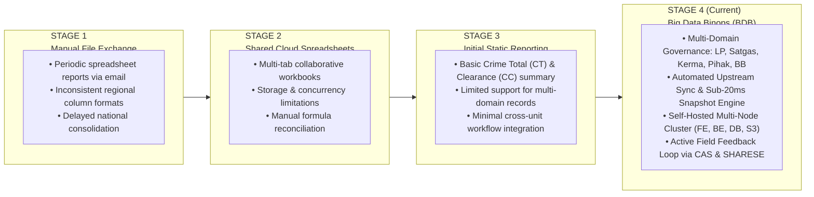
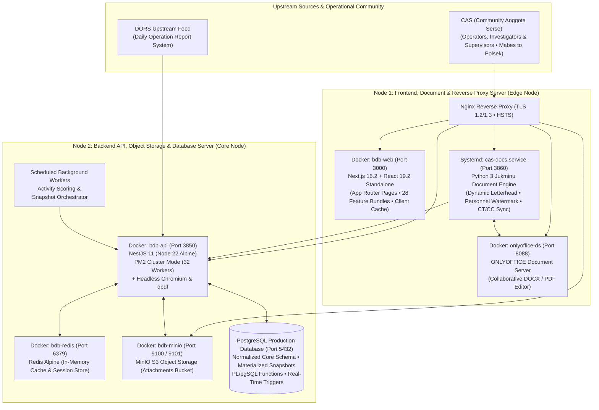

# Big Data Binops (BDB) — Powered by CAS (*Community Anggota Serse*)

> 🌐 **Language / Pilihan Bahasa:** [**🇬🇧 English (Active)**](README.md) &nbsp;|&nbsp; [**🇮🇩 Bahasa Indonesia (Edisi Resmi)**](README.id.md)

[%20v2.6-1E40AF.svg?style=flat-square)](#)
[](#-overview--transformation-journey)
[](https://www.typescriptlang.org/)
[](https://nestjs.com/)
[](https://nextjs.org/)
[](https://www.postgresql.org/)
[](#4-official-document-automation--onlyoffice-integration)
[](#5-zero-trust-security--access-governance)
[](LICENSE.md)
[-0A66C2.svg?style=flat-square&logo=linkedin&logoColor=white)](https://www.linkedin.com/in/omeko42/)

**Big Data Binops (BDB)** is an enterprise operational data governance, case lifecycle management, and law enforcement analytics platform engineered for **Biro Pembinaan dan Operasional (Robinopsnal) Bareskrim Polri**.

Supported by **CAS (*Community Anggota Serse*)** — an active operational community of criminal investigation personnel, operators, and supervisory officers across Indonesia — **Big Data Binops (BDB)** consolidates multi-domain operational records across all four organizational tiers (**Mabes → Polda → Polres → Polsek**) into a unified, high-speed analytical ecosystem.

---

## 💡 Overview & Transformation Journey

**Big Data Binops (BDB)** evolved through four progressive stages of operational data management, transitioning from manual file exchanges to a modern, self-hosted enterprise platform:



### Core Design Principles
1. **Single Source of Truth & Zero Double-Entry**: Automates upstream synchronization with **DORS (*Daily Operation Report System*)** while preserving source data integrity (upstream records can be enriched and updated operationally without destructive deletion).
2. **Full Organizational Alignment (`Perkap 6/2017 jo. Perpol 4/2025`)**: Supports the four core functional divisions of **Robinopsnal**:
   - **Bagrenopsnal**: Police operations & task forces (*Operasi & Satgas*), operation case tagging, *Sprin/Renops* document repository, and leadership directives (*Jukrah*).
   - **Bagkerma**: Domestic and international cooperation agreements (*MoU/PKS*) with automated expiration monitoring.
   - **Baganev**: Sub-20ms **CT / CP / CC / CR & Performance Index** engine, prominent & attention case monitoring (*Susopsgas*), and cross-jurisdiction subject analytics.
   - **Bagyanmas & Support**: Public service reporting integration, user guidance media hub (*Panduan*), and in-app issue tracking (*Bug Report*).
3. **Standardized National Nomenclature**: Enforces official abbreviated nomenclature across all views, filters, and reports for regional jurisdictions (`Sumut`, `Sumsel`, `Kepri`, `Metro Jaya`, `Jabar`, `Jateng`, `DIY`, `Jatim`, etc.), crime groups (`KRIMUM`, `KRIMSUS`, `NARKOBA`), sub-groups (`TIPIDUM`, `TIPIDEKSUS`, `TIPIDKOR`, `TIPIDTER`, `TIPIDSIBER`, `TIPIDPPAPPO`, `TIPIDNARKOBA`), and organizational units (`DITKRIMUM`, `DITKRIMSUS`, `DITNARKOBA`, `DITSIBER`, `DITPPAPPO`, `SATRESKRIM`, `UNIT RESKRIM`).

---

## 🏛️ Multi-Node System Architecture



> 📖 **Technical Documentation & Reference Guides**:
> - [**`docs/STRATEGIC_GOVERNANCE_AND_EVOLUTION.md`**](docs/STRATEGIC_GOVERNANCE_AND_EVOLUTION.md) — Strategic Governance Overview, SOTK Matrix & 6-Pillar Architecture Roadmap
> - [**`ARCHITECTURE.md`**](ARCHITECTURE.md) — System Architecture & Engineering Decision Records (ADRs 001–006)
> - [**`docs/SERVER_ARCHITECTURE_AND_INVENTORY.md`**](docs/SERVER_ARCHITECTURE_AND_INVENTORY.md) — Dual-Node Topology, Service Inventory & Backend Submodules
> - [**`database/schema/DATABASE_INVENTORY.md`**](database/schema/DATABASE_INVENTORY.md) — Relational Schema Catalog Across 12 Functional Domains
> - [**`frontend/FRONTEND_ROUTES_AND_MODULES.md`**](frontend/FRONTEND_ROUTES_AND_MODULES.md) — Next.js App Router Pages & 28 Feature Bundles Mapping
> - [**`docs/API_INTEGRATION_GUIDE.md`**](docs/API_INTEGRATION_GUIDE.md) & [**`docs/GENAI_INTEGRATION_SPEC.md`**](docs/GENAI_INTEGRATION_SPEC.md) — External API & AI/RAG Integration Specifications
> - [**`CHANGELOG.md`**](CHANGELOG.md) — Platform Release History (up to v2.6)

---

## 🚀 Key Platform Modules & Capabilities

### 1. Executive Dashboard (`Ringkasan`) & Geospatial Crime Map (`Peta Kejahatan`)
- **Sub-20ms Executive Telemetry (`/cms/dashboard/main`)**: Pre-warmed snapshot cache (`bdb_anev_dashboard_snapshot`) delivering instant **Crime Total (CT)**, **Crime Clearance (CC)**, **Clearance Rate (CR)**, and regional breakdown charts.
- **Interactive Top-10 Hover Flyouts**: Both **10 Kejahatan Tertinggi** (*Top 10 Crimes*) and **10 Satker CT/CC Tertinggi** (*Top 10 Units*) feature interactive hover flyouts detailing the Top 9 contributing Polda/Satker plus a 10th `LAINNYA` (*Others*) row summing to 100%.
- **Geospatial Crime Map (`/cms/dashboard/peta-kejahatan`)**: Interactive jurisdiction map (*Peta Wilkum*, *Peta Jalan*, *Satelit*, *Google Maps*, *Heatmap*, *Titik TKP*) with hierarchical **Satker + Jajaran di Bawahnya** filtering so regional directorates and resorts can inspect their entire subordinate jurisdiction tree.
- **Coserse AI Placeholder**: Dedicated sidebar entry reserved for future on-premise conversational AI integration (*Cosersebot*).

### 2. Case Lifecycle Management (`Daftar LP`, `Detail LP`, `Arsip Limpah`) & `Kinerja Perkara`
- **Unified Filter Popovers & Concise 2-Line Tables (`/cms/laporan-polisi`)**: Anchored filter modals (*Kelompok*, *Satker*, *Kejahatan*, *Periode*), 2-line clamped cells with clean ellipsis, bulk status updates, and hierarchical supervision mode.
- **Upstream DORS Integrity Protection (`/cms/laporan-polisi/[id]`)**: Clearly labels upstream records with a `DORS` badge, allowing investigators to edit and enrich details (such as evidence units or workflow documents) while disabling destructive deletion on upstream records.
- **Kinerja Perkara (`/cms/report/kinerja-perkara`)**: Computes **CT**, **CP (Aktual & Tunggakan)**, **CC (Aktual & Tunggakan)**, **PR/CR (Rumus Lama & Baru)**, **PERMA Tipiring**, and **Performance Index** across all 4 organizational tiers.

### 3. National Registries (`Pihak Terlibat`, `Pihak Sering Terlibat`, `Barang Bukti`) & `Susopsgas`
- **Involved Parties & Repeat Subjects (`/cms/laporan/rekap-pihak-terlibat`, `/cms/laporan/pihak-sering-terlibat`)**: Sub-20ms role switching (`Semua`, `Tersangka`, `DPO`, `Terlapor`, `Korban`, `Saksi`, `Pelapor`) backed by `bdb_pihak_terlibat_fast_cache` and client pre-fetching, including corporate subject tracking (*Direktur Utama*) and cross-jurisdiction detection.
- **Standardized Evidence Registry (`/cms/laporan/rekap-barang-bukti`)**: Unified **`JENIS & NAMA / DETAIL BARANG`** column classifying items into **16 Canonical Indonesian Evidence Categories** (*Dokumen & Surat Berharga*, *Perangkat Elektronik & Komunikasi*, *Kendaraan & Alat Angkut*, *Narkotika, Psikotropika & Obat*, *Alat Penerangan & Kelistrikan*, *Hewan & Ternak*, *Pakaian, Tekstil & Aksesoris*, etc.) paired with separated numeric quantities and standardized Indonesian measurement units (`Unit`, `Buah`, `Lembar`, `Helai`, `Ekor`, `Gram (g)`, `Kg`, `Liter (L)`, `Meter (m)`, etc.).
- **Susopsgas (`/cms/laporan/kasus-menonjol`, `/cms/laporan/kasus-atensi`, `/cms/laporan/rekap-operasi-satgas`)**: Unified management and executive recapitulation of prominent cases (*Susjol*), attention cases (*Susatensi*), and active police task forces (*Operasi & Satgas*).

### 4. Official Document Automation & ONLYOFFICE Integration
- **13-Sheet Periodic Evaluation Suite (`/cms/report/anev-ctcc`)**: Built-in WYSIWYG generator for the 13 official periodic evaluation sheets bound to live database telemetry.
- **Jukminu Document Microservice & ONLYOFFICE (`cas_doc_service.py` + `onlyoffice-ds`)**: Generates standardized `.docx` and `.pdf` official reports with dynamic unit letterheads (*Kop Surat*), signature blocks, and personnel watermarks.
- **Cooperation Repository (`Kerma`) & Guidance Media Hub (`Panduan`)**: Manages institutional MoU/PKS documents (`/cms/kerma`) and provides an in-app PDF & adaptive video streaming hub (`/cms/panduan`).

### 5. Zero-Trust Security, SHARESE Collaboration & System Governance
- **SHARESE Internal Network (`/cms/broadcaster`, `/cms/sharese-koneksi`)**: Case-linked tactical feed with live **`@username` autocomplete**, real-time direct messaging (*Obrolan*) with fixed-width bubble containers and rich actions, streamlined 3-card personnel profiles, and full-page security settings (`/cms/profile-keamanan`).
- **FIDO2 / WebAuthn Hardware Passkey & Multi-Factor Security**: Supports biometric/hardware passkeys, TOTP 2FA, 6-Digit PIN, Email OTP, and trusted device management.
- **Combined Activity Scoring & Role Governance (`/cms/master/user`, `/cms/master/menu`)**:
  - **Combined Activity Score**: Evaluates 30-day personnel engagement by combining **50% login day frequency** + **50% active session duration**.
  - **Role `sharese` for Passive Accounts**: Automatically assigns zero-activity accounts to the `sharese` role until reactivated by a supervisor or administrator.
  - **Role `testing` (Read-Only Vendor/Partner Mode)**: Grants visibility across all application menus for inspection while strictly blocking write/update/delete operations (`HTTP 403`).
- **Inbound & Outbound Integration Portals, Master Reference & Multi-SMTP Failover**:
  - **Inbound & Outbound Portals (`/cms/integrasi/*`)**: Configurable integration endpoints with persistent audit logs, simultaneous DORS staging metrics (`/cms/integrasi/dors-data`), and 100% reconciled master data mappings (`/cms/integrasi/master-data-gap`).
  - **Master Reference Hub (`/cms/master-ref`)**: Includes dedicated CRUD catalogs for **Kelompok Kejahatan (`KRIMUM`, `KRIMSUS`, `NARKOBA`)** and **Sub-Kelompok Tindak Pidana (`TIPID...`)**.
  - **Multi-SMTP Email Failover (`/cms/pengaturan/email`)**: Supports primary official SMTP with secondary fallback and inline `.env` configuration preview.

---

## 📂 Repository Structure

```text
├── backend/                                    # NestJS 11 Backend API (PM2 Cluster Mode)
│   ├── Dockerfile.bdb & ecosystem.config.js    # Container build & PM2 cluster configuration
│   ├── cron_activity_cache.js                  # Scheduled personnel activity scoring worker
│   └── src/
│       ├── app_core/                           # Auth, Passkey, RBAC, TypeORM, Redis & Mail
│       ├── bdb/                                # 26 Core Operational Submodules
│       └── external/                           # Managed External REST API Gateway
├── frontend/                                   # Next.js 16.2 Standalone Portal & Document Service
│   ├── server.js                               # Standalone HTTP server with Cache-Control guard
│   ├── FRONTEND_ROUTES_AND_MODULES.md          # Complete route & feature bundle documentation
│   ├── services/cas-doc-service/               # Python 3 Jukminu & ONLYOFFICE integration service
│   └── src/
│       ├── app-routes-manifest.json            # App Router path manifest
│       ├── modules/                            # 28 Production Client Feature Bundles
│       └── styles/theme.modern.css             # Adaptive Light & Dark Mode Design System
├── database/                                   # PostgreSQL Schema & Sequential Migrations
│   ├── schema/
│   │   ├── 000_live_production_schema.sql      # Complete Relational DDL Schema
│   │   └── DATABASE_INVENTORY.md               # Domain-by-domain relational schema catalog
│   └── migrations/                             # Sequential SQL Migrations (000 through 089)
├── docs/                                       # Architecture, Governance & Integration Guides
│   ├── STRATEGIC_GOVERNANCE_AND_EVOLUTION.md   # Strategic Governance & 6-Pillar Blueprint
│   ├── SERVER_ARCHITECTURE_AND_INVENTORY.md    # Multi-Node Server & Module Inventory
│   ├── API_INTEGRATION_GUIDE.md                # External REST API Integration Reference
│   ├── GENAI_INTEGRATION_SPEC.md               # AI / RAG Downstream Ingestion Specification
│   └── infrastructure/                         # Sanitized Nginx, Docker Compose & Cron templates
├── README.md                                   # Main Documentation (English)
├── README.id.md                                # Main Documentation (Bahasa Indonesia)
├── ARCHITECTURE.md                             # Architecture Decision Records (Bilingual)
├── CHANGELOG.md                                # Platform Release History (Bilingual)
├── CONTRIBUTING.md                             # Contribution & Engineering Standards (Bilingual)
├── CITATION.cff                                # Technical Citation Metadata
├── LICENSE.md                                  # Institutional License, NDA, SLA & Security Policy
└── .env.example                                # Sanitized Environment Variable Template
```

---

## 🛠️ Technology Stack

| Layer | Technologies |
| :--- | :--- |
| **Backend API (`bdb-api`)** | NestJS 11, TypeScript 5.7, TypeORM 0.3, Node.js 22 (Alpine), PM2 Cluster, `@simplewebauthn/server` (FIDO2), Puppeteer + `qpdf`, ExcelJS, `pdfmake` |
| **Frontend Portal (`bdb-web`)** | Next.js 16.2 (App Router, Standalone), React 19.2, PrimeReact 10.9, Chart.js 4.5, Lucide React, Axios, IndexedDB |
| **Document Engine (`cas-docs`)** | Python 3 `ThreadingHTTPServer`, ONLYOFFICE Document Server (`onlyoffice-ds`), SQLite metadata store |
| **Database & Cache** | PostgreSQL (Materialized Snapshots, PL/pgSQL Triggers, GIN Trigram Indexes, Advisory Locks), Redis (`redis:alpine`) |
| **Object Storage & Infra** | MinIO S3 Object Storage, Nginx Reverse Proxy (TLS 1.2/1.3, HSTS), Docker Engine |

---

## 🔒 Security, Licensing & Zero-Secret Governance

- **Institutional License, NDA & SLA ([`LICENSE.md`](LICENSE.md))**: Engineered by **Eko Agung (`@omeko42`)** for official operational governance within **Robinopsnal Bareskrim Polri** and **CAS (*Community Anggota Serse*)**.
- **Regulatory Compliance**: Designed in accordance with **UU No. 27 Tahun 2022 (UU PDP)**, **Perkap 6/2017 jo. Perpol 4/2025**, and **Perkap 6/2019**.
- **Zero-Secret Repository**: All files in this repository are strictly sanitized. No production passwords, cryptographic secrets, private IP addresses, internal domains, or personal identifiable information (PII) are stored in version control.

---

## 👨‍💻 Creator & System Architect

- **Eko Agung** — [GitHub (`@omeko42`)](https://github.com/omeko42) &nbsp;|&nbsp; [LinkedIn (`in/omeko42`)](https://www.linkedin.com/in/omeko42/)  
  *Full-Stack Engineer & System Architect — Robinopsnal Bareskrim Polri*  
  *Founder of **CAS (Community Anggota Serse)** & Lead Engineer of **Big Data Binops (BDB)***
