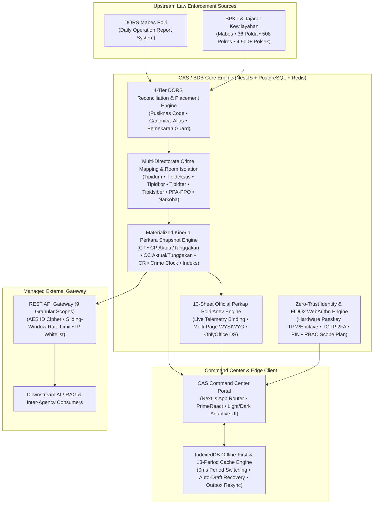

# Crime Analytic System (CAS) & Big Data Binops (BDB)

[](https://www.typescriptlang.org/)
[](https://nestjs.com/)
[](https://nextjs.org/)
[](https://www.postgresql.org/)
[](#4-fido2--webauthn-hardware-passkey--zero-trust-security-suite)
[](#security--governance)
[](#)

Enterprise-grade criminal intelligence, operational case lifecycle management, and law enforcement analytics platform engineered for **Bareskrim Polri**. The platform ingests, reconciles, standardizes, and analyzes over **1.3+ million nationwide Police Reports (*Laporan Polisi* / LP)** across all 4 territorial tiers (**Mabes Polri $\to$ Polda $\to$ Polres $\to$ Polsek**) and **6 Specialized Criminal Investigation Directorates** across Indonesia.

---

## 🏛️ System Architecture



---

## 🚀 Key Engineering Capabilities

### 1. 4-Tier DORS Ingestion & Hierarchical Jurisdiction Engine
- **High-Volume Bidirectional Reconciliation**: Continuously ingests raw operational records (`bdb_dors_raw_lp`) from **DORS Mabes Polri** into normalized relational structures (`bdb_laporan_polisi`, `bdb_lp_tindak_pidana_dors`, `bdb_dokumen`, `bdb_lp_pelimpahan`).
- **4-Tier Guard Verification (`Mabes → Polda → Polres → Polsek`)**: Resolves territorial ownership using multi-signal ranking (`kode_pusiknas`, `kode_canonical`, `dors_kode`, `nama_satker_dors`, and `bdb_dors_satker_map`) with automated **Pemekaran Polres/Polsek** hierarchy reconciliation and inter-agency transfer (*Pelimpahan Internal & Eksternal*) tracking.
- **Role-Scoped Monitoring Plan (`LpMonitoringAccessService`)**: Dynamically computes hierarchical read/write/transfer permissions across territorial parent-child trees (including unified `Polsek` $\leftrightarrow$ `Unit Reskrim Polsek` scopes and `Polda Directorate` $\to$ `Polres Satreskrim/Satresnarkoba/Satresppa` oversight).

### 2. Crime Clearance (CT / CP / CC / CR) & Multi-Directorate Taxonomy Engine
- **End-to-End Case Lifecycle Tracking**: Tracks criminal cases from initial report (**LP / Belum Update**) through **Penyelidikan (Lidik)**, **Penyidikan (Sidik)**, **SPDP**, **Tahap I**, **P19**, **P21**, to final resolution via **Tahap II**, **Henti Lidik (SP2Lid)**, **Henti Sidik (SP3 / Restorative Justice)**, and **PERMA Tipiring**.
- **Versioned Crime Group Taxonomy**: Maps 780+ statutory crime classifications (`cm_jenis_kejahatan`) into 6 specialized investigation domains (**Tipidum, Tipideksus, Tipidkor, Tipidter, Tipidsiber, PPA-PPO, and Narkoba**) while automatically isolating non-criminal/traffic offenses (**Korlantas / Satlantas**) to prevent cross-domain metric distortion.
- **High-Speed Snapshot Materialization**: Non-blocking background snapshot orchestrator (`bdb_kinerja_perkara_snapshot`) delivering sub-second national and regional aggregations of **Crime Total (CT)**, **Crime Process (CP Aktual & Tunggakan)**, **Crime Clearance (CC Aktual & Tunggakan)**, **Clearance Rate (CR)**, **Crime Risk**, **Crime Clock**, and **5-Level Composite Performance Index**.

### 3. 13-Sheet Official Perkap Polri WYSIWYG Document & Anev Engine
- **Authentic Perkap Polri Document Suite**: Built-in Google Docs / Word-grade multi-page WYSIWYG document engine generating all **13 Official Perkap Polri Periodic Evaluation Sheets (*Lembar Anev Periodik*)**.
- **Live Telemetry & Layout Controls**: Supports dynamic Kop Polri header toggles, interactive reviewer annotation cards, dynamic Polri (NRP) & PNS (NIP) signatory blocks, horizontal rulers, collapsible document outlines, and seamless page-break reflow.

### 4. FIDO2 / WebAuthn Hardware Passkey & Zero-Trust Security Suite
- **Hardware-Bound Biometric Passkeys (`FIDO2 / WebAuthn`)**: Passwordless cryptographic authentication bound to device hardware (`Windows Hello TPM`, `Apple Touch ID / Face ID Secure Enclave`, `Android Keystore`) with mandatory user verification (`userVerification: 'required'`), exact `clientDataJSON` challenge binding, and signature counter clone detection.
- **Multi-Factor Verification & Device Governance**: Supports **TOTP 2FA (Google Authenticator)**, **6-Digit Security PIN**, and **Email OTP**, paired with self-service **Trusted Device Audit & Revocation (`Otorisasi Cabut Akses Gawai`)**.
- **Cross-Tab Instant Session Sync**: Real-time `BroadcastChannel` and `storage` event synchronization ensuring instant multi-tab logout and automatic local cache sanitization on account switch or superadmin impersonation.

### 5. Offline-First IndexedDB & 13-Period Global Snapshot Cache
- **Zero-Latency Period Switching**: Automatically preloads **13 temporal snapshot partitions (Full Year + 12 Monthly Partitions)** into an encrypted-context local IndexedDB store (`bdb_offline_db`) for instant dashboard and report rendering.
- **Resilient Field Operations**: Automatic form-draft persistence (`bdbSaveDraft` / `bdbRestoreDraft`) and an offline mutation outbox (`bdbQueueOutbox`) that automatically resynchronizes pending case updates upon network recovery.

### 6. Managed External API & GenAI RAG Gateway
- **9 Granular Authorization Scopes**: `laporan_polisi.read`, `klasifikasi`, `status`, `penanganan`, `tkp`, `kronologi`, `kerugian`, `pihak_terlibat`, and `barang_bukti`.
- **Hardened Perimeter**: Sliding-window rate limiting (120 req/min), per-client IP whitelisting, and AES-GCM opaque ID ciphers (`id-cipher.util.js`) preventing sequential ID enumeration.

---

## 📂 Repository Structure

```text
├── backend/
│   └── src/
│       ├── anev/               # 13-Sheet Official Perkap Polri Anev & Telemetry Engine
│       ├── auth/               # FIDO2 WebAuthn Passkey, TOTP 2FA, PIN, JWT & Device Revocation
│       ├── dors/               # DORS Mabes Polri Bidirectional Sync & Scheduler Service
│       ├── jukrah/             # SHARESE Tactical Directive & Intelligence Feed Service
│       ├── kinerja-perkara/    # CT/CP/CC/CR Snapshot Engine, Crime Clock & Performance Index
│       ├── laporan-polisi/     # 4-Tier LP Placement, Guard Verification & Regional Scope Plan
│       ├── satker/             # Master Satker Hierarchy (Mabes → Polda → Polres → Polsek)
│       ├── user/               # Personnel Management, Impersonation & Role-Based Access Control
│       └── workflow/           # Case Lifecycle Document Workflow (Lidik, Sidik, SP3, Tahap II)
├── frontend/
│   └── src/
│       ├── modules/
│       │   ├── auth/           # Session Manager, Cross-Tab Sync, Offline IndexedDB & FIDO2 UI
│       │   ├── dors/           # DORS Ingestion Monitor & Scheduler Control UI
│       │   ├── kinerja-perkara/# Interactive CT/CP/CC/CR Analytics & Drilldown Matrix
│       │   └── laporan-polisi/ # Case Registry, Bulk Status Updater & Filter Engine
│       └── styles/
│           └── theme.modern.css# Adaptive Light & Dark Mode Design System (--cas-* tokens)
├── database/
│   └── migrations/             # PostgreSQL Schema Migrations (WebAuthn Passkeys, Indexes)
├── docs/
│   ├── API_INTEGRATION_GUIDE.md# Managed External REST API Reference & Security Spec
│   └── GENAI_INTEGRATION_SPEC.md# LLM / RAG Downstream Ingestion Specification
├── .env.example                # Sanitized Environment Variable Template
└── SECURITY.md                 # Security Architecture, Vulnerability Disclosure & UU PDP Compliance
```

---

## 🛠️ Technology Stack

| Layer | Technologies |
| :--- | :--- |
| **Backend API** | NestJS, TypeScript, TypeORM, Node.js, SimpleWebAuthn (FIDO2), Express, Puppeteer |
| **Frontend Portal** | Next.js (App Router, SSR, Turbopack), React 19, PrimeReact, Lucide Icons, Chart.js |
| **Data & Caching** | PostgreSQL (Materialized Snapshots, Recursive CTEs, Advisory Locks), Redis, IndexedDB |
| **Storage & Docs** | MinIO Object Storage (`S3`-compatible), OnlyOffice Document Server |
| **Infrastructure** | Docker, Nginx Reverse Proxy (TLS 1.3 / HSTS), Multi-Node Isolated Linux Cluster |

---

## 🔒 Security & Governance

- **Regulatory Compliance**: Engineered in strict accordance with **UU No. 27 Tahun 2022 tentang Perlindungan Data Pribadi (UU PDP)** and internal Polri cryptographic standards.
- **Zero-Secret Version Control**: All production credentials, private keys, and internal network topologies are strictly excluded from version control. See [`.env.example`](.env.example) and [`SECURITY.md`](SECURITY.md) for configuration guidelines.

---

## 👨‍💻 Maintainer & Lead Architect

- **Eko Agung** ([@omeko11](https://github.com/omeko11))  
  *Senior Full-Stack Engineer / Lead System Architect*
