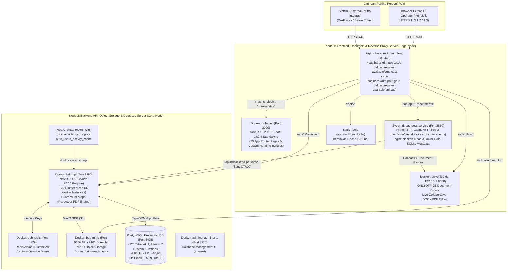

# Arsitektur Real & Inventaris Server Produksi — Big Data Binops (BDB) & CAS (Community Anggota Serse)

> **Status Dokumen:** Hasil Audit Forensik & Ekstraksi Langsung Server Produksi (Oktober 2026)  
> **Identitas Platform:** **Big Data Binops (BDB)** — Platform Pengolahan Data Operasional Kompleks Biro Pembinaan dan Operasional (Robinopsnal) Bareskrim Polri, yang digerakkan oleh ekosistem **CAS (*Community Anggota Serse* — 1.024+ Anggota Reserse & KBO se-Indonesia)**.  
> **Standar Keamanan:** Seluruh alamat IP internal, kredensial database, kunci privat TLS, dan *secret token* telah disanitasi sesuai kebijakan **Zero-Secret Repository** (`SECURITY.md`).

---

## 1. Topologi Multi-Node Server Produksi

Secara aktual di lingkungan produksi, **CAS (Crime Analytic System)** dideploy menggunakan arsitektur **Dual-Node Terpisah (Frontend/Edge Node & Backend/Data Node)** yang terhubung melalui jaringan privat internal:



---

## 2. Rincian Komponen pada Node 1 (Frontend & Document Server)

### 2.1. Nginx Reverse Proxy (`/etc/nginx/sites-available/`)
1. **`cms.cas` (`cas.bareskrim.polri.go.id`)**:
   - Terminasi SSL/TLS (`TLSv1.2`, `TLSv1.3`, HSTS `max-age=31536000`).
   - Buffer header besar (`large_client_header_buffers 8 128k`, `client_header_buffer_size 64k`) untuk mengakomodasi JWT dan header autentikasi perangkat.
   - Routing lokasi:
     - `/` & `/cms` & `/login` $\rightarrow$ `http://127.0.0.1:3000` (`bdb-web` Next.js container) dengan `Cache-Control: no-store, no-cache, must-revalidate, max-age=0` agar perubahan hak akses/session dan hotfix bundle langsung aktif tanpa terjebak cache browser.
     - `/api/` $\rightarrow$ `http://<BACKEND_PRIVATE_IP>:3850` (`bdb-api` NestJS container, timeout `300s`).
     - `/doc-api/` & `/documents/` $\rightarrow$ `http://127.0.0.1:3860` (`cas-docs.service`).
     - `/onlyoffice/` $\rightarrow$ `http://127.0.0.1:8088/` (`onlyoffice-ds`, mendukung WebSocket `Upgrade` dan `client_max_body_size 100M`).
     - `/tools/` $\rightarrow$ `/var/www/cas_tools/` (mengunduh utilitas `Bersihkan-Cache-CAS.bat`).
2. **`api.cas` (`api-cas.bareskrim.polri.go.id`)**:
   - Menangani trafik langsung ke API gateway (`http://<BACKEND_PRIVATE_IP>:3850`, `client_max_body_size 24m`).
   - Mengatur kebijakan CORS dinamis (`cas.bareskrim.polri.go.id`, `localhost`) termasuk header khusus `X-Device-Token` dan `X-Offline-Synced`.
   - `/bdb-attachments/` $\rightarrow$ `http://<BACKEND_PRIVATE_IP>:9100` (MinIO Object Storage untuk streaming/unduhan lampiran dokumen).

### 2.2. Container `bdb-web` (Next.js 16.2.10 Application Server)
- **Path di dalam Container:** `/usr/src/app`
- **Runtime:** `node server.js` (Next.js `16.2.10` Standalone Mode, React `19.2.4`, PrimeReact `10.9.8`, Chart.js `4.5.1`, Lucide React `1.24.0`).
- **Custom Header Override di `server.js`:** Mengintersepsi `http.ServerResponse.prototype.setHeader` untuk mengubah `Cache-Control: immutable` menjadi `public, max-age=0, must-revalidate` sehingga pembaruan bundel JS kritis langsung diterima oleh seluruh klien.
- **Cakupan Halaman (73 App Router Routes di `.next/server/app`):**
  - **Autentikasi & Keamanan:** `/login`, `/login-otp`, `/otp`, `/totp`, `/pin`, `/register`, `/register-success`, `/forgot-password`, `/access`, `/guest/invitation/[code]/[organisasi]`.
  - **Dashboard Eksekutif & Geospasial:** `/dashboard`, `/cms/dashboard/main`, `/cms/dashboard/heatmap`.
  - **Operasional Laporan Polisi (LP):** `/cms/laporan-polisi`, `/cms/laporan-polisi/[id]`, `/cms/laporan-polisi/arsip-pelimpahan`, `/cms/laporan/penanganan-lp`, `/cms/laporan/distribusi-lp`, `/cms/laporan/laporan-kejahatan`.
  - **Rekapitulasi Nasional:** `/cms/laporan/rekap-laporan-polisi`, `/cms/laporan/rekap-barang-bukti`, `/cms/laporan/rekap-pihak-terlibat`, `/cms/laporan/rekap-operasi-satgas`, `/cms/laporan/rekap-kerma`.
  - **Kasus Menonjol, Atensi & Kerma:** `/cms/laporan/kasus-menonjol`, `/cms/laporan/kasus-menonjol/lihat`, `/cms/laporan/kasus-atensi`, `/cms/laporan/kasus-atensi/lihat`, `/cms/kerma`, `/cms/kerma/lihat`.
  - **Pelaporan Kinerja Perkara & ANEV:** `/cms/report/kinerja-perkara`, `/cms/report/anev-lp`, `/cms/report/anev-ctcc`, `/cms/report/generate`, `/cms/report/cetak`.
  - **Integrasi DORS & Rekonsiliasi:** `/cms/integrasi/dors`, `/cms/integrasi/dors-data`, `/cms/integrasi/dors-unmapped`, `/cms/integrasi/master-data-gap`, `/cms/integrasi/satker-legacy`, `/cms/integrasi/portal-keluar`.
  - **Manajemen Master Data:** `/cms/master/user`, `/cms/master/satker-tree`, `/cms/master/satker-eksternal`, `/cms/master/jenis-kejahatan`, `/cms/master/pasal`, `/cms/master/jenis-barang-bukti`, `/cms/master/alur-dokumen`, `/cms/master/operasi-satgas`, `/cms/master/kerma`, `/cms/master/menu`, `/cms/master/organisasi*`, `/cms/master/sub-golongan-kamtibmas`, `/cms/master-ref`, `/cms/master/[slug]`.
  - **Komunikasi SHARESE, Audit & Pengaturan:** `/cms/broadcaster`, `/cms/pengumuman`, `/cms/audit-log`, `/cms/audit-log/uji-beban`, `/cms/panduan`, `/cms/panduan/kelola`, `/cms/pencarian`, `/cms/profile`, `/cms/profile/reset-password`, `/cms/profile/reset-totp`, `/cms/pengaturan/*`.

### 2.3. Layanan `cas-docs.service` (`/var/www/cas_docs/cas_doc_service.py`) & `onlyoffice-ds`
- **Service Systemd:** `cas-docs.service` berjalan pada port `3860` sebagai daemon Python (`cas_doc_service.py`) yang terhubung dengan database lokal SQLite (`cas_documents.db`) dan container Docker `onlyoffice-ds` (`127.0.0.1:8088`).
- **Fungsi Utama (Standar Jukminu Polri):**
  - Menghasilkan dokumen `.docx` dan `.pdf` Laporan Periodik / ANEV dengan penamaan standar `CAS-{hash_8}-{DDMMYYYY}.docx`.
  - Menyusun **Kop Surat Dinamis** sesuai tingkat Satker (Mabes/Bareskrim, Polda, Polres, Polsek) dan Direktorat/Satuan Fungsi (Tipidum/Krimum, Tipidter, Tipidkor, Tipidsiber, PPA-PPO, Narkoba).
  - Menyusun **Blok Tanda Tangan Dinamis** (`a.n. Pimpinan`, Jabatan, Nama, Pangkat, NRP/NIP), **Watermark Dinamis per Personil**, penomoran halaman mulai halaman 2, serta *Catchword* (kata penghubung) di sudut kanan bawah sesuai tata naskah dinas Polri.
  - Melakukan sinkronisasi angka CT, CC, dan Clearance Rate secara langsung ke API Backend (`/api/bdb/kinerja-perkara/*`) melalui endpoint `/doc-api/sync-cas`.

---

## 3. Rincian Komponen pada Node 2 (Backend & Data Server)

### 3.1. Container `bdb-api` (NestJS 11 Cluster Engine)
- **Path di dalam Container:** `/usr/src/app`
- **Image & Runtime:** `node:22.14.0-alpine` (`Dockerfile.bdb`) dilengkapi paket Alpine `chromium`, `nss`, `freetype`, `harfbuzz`, `ttf-freefont`, dan `qpdf` (untuk pembuatan PDF via Puppeteer dan enkripsi dokumen dengan password).
- **Manajemen Proses:** Dijalankan menggunakan `pm2-runtime start ecosystem.config.js` dengan `exec_mode: 'cluster'` dan `instances: 32` (32 worker proses paralel pada port `3850`).
- **Koordinasi Antar-Worker (Cluster Safety):**
  - Menggunakan `bdb/common/cluster-instance.util.ts` dan PostgreSQL Advisory Locks (`pg_try_advisory_lock` pada `bdb/common/job-queue.service.ts`) agar cron job internal dan regenerasi snapshot (`bdb_kinerja_perkara_snapshot`, `bdb_anev_rekap_snapshot`, dll.) hanya dieksekusi oleh 1 proses pada satu waktu dan tidak memblokir `app.listen(3850)`.

### 3.2. Daftar Lengkap Modul Backend (`/usr/src/app/src` & `/usr/src/app/dist`)

| Kelompok Modul | Sub-Modul (`backend/src/...`) | Controller / Service Utama & Tanggung Jawab |
| :--- | :--- | :--- |
| **`app_core`** | `auth` (`device`, `permission`, `role`, `route`, `user`) | Autentikasi multi-tahap (Password + PoW/SVG Captcha, OTP Email, PIN 6-Digit, TOTP, **WebAuthn Passkey FIDO2**), manajemen perangkat terpercaya (`auth_devices`), RBAC & mutasi personil (`user.service.ts`). |
| **`app_core`** | `database`, `helper`, `migrations`, `network`, `swagger` | Konfigurasi TypeORM & Pool PostgreSQL (`dataSource.ts`), Redis Cache (`cache.module.ts`), dekorator `@CurrentUser()`, format respons standar, dan dokumentasi Swagger. |
| **`bdb`** | `laporan-polisi` | Operasi inti LP (`laporan-polisi.controller.ts`, `laporan-polisi.service.ts`), enkripsi ID LP (`id-cipher.util.ts`), rekonsiliasi gap master data (`master-data-gap.service.ts`), validasi hierarki satuan kerja & status penyidikan. |
| **`bdb`** | `kinerja-perkara` | Engine analitik **CT, CP, CC, PR, CR (Rumus Lama & Baru), dan Indeks Kinerja** (`kinerja-perkara.service.ts`, `clearance-rate.util.ts`, `processed-rate.util.ts`, `indeks.util.ts`) beserta worker ekspor PDF/XLSX (`pdf-render.worker.ts`, `xlsx-render.worker.ts`). |
| **`bdb`** | `anev` | Engine **ANEV Laporan Polisi, ANEV CT/CC, dan Generator 13 Lampiran Eksekutif** (`anev.controller.ts`, `anev.service.ts`). |
| **`bdb`** | `dors` | Sinkronisasi terjadwal & manual dengan **DORS Stamaops Polri** (`dors.controller.ts`, `dors.service.ts`, `sync-log.store.ts`), normalisasi relasi ke `bdb_dors_lp*` dan `bdb_laporan_polisi`. |
| **`bdb`** | `satker` & `satker-eksternal` | Manajemen pohon organisasi Polri 4 tingkat (`MABES` $\rightarrow$ `POLDA` $\rightarrow$ `POLRES` $\rightarrow$ `POLSEK` beserta Subdit/Sat/Unit), rekonsiliasi satker legacy (`satker-legacy-reconciliation.service.ts`), dan instansi eksternal (`satker-eksternal.service.ts`). |
| **`bdb`** | `workflow` & `lp-pelimpahan` | Siklus hidup dokumen penyidikan (`Mindik`, `Lidik`, `Sidik`, `SP2Lid`, `SP3`, `RJ`, `P19`, `P21`, `Tahap II`) dan alur pelimpahan LP internal/eksternal/antar-Polda (`lp-pelimpahan.service.ts`). |
| **`bdb`** | `jukrah` | Fitur **Jukrah & Atensi Pimpinan** pada LP (`jukrah.controller.ts`, `jukrah.service.ts`) beserta kontrol visibilitas berjenjang dan pencatatan waktu baca (`bdb_jukrah_view`). |
| **`bdb`** | `pihak-terlibat` & `dpo` | Analitik & pencarian nasional Terlapor/Tersangka, Korban, Saksi, Pelapor berdasarkan NIK/NRP/Korporasi (`pihak-terlibat.service.ts`) serta manajemen Daftar Pencarian Orang (`dpo.service.ts`). |
| **`bdb`** | `barang-bukti` | Rekapitulasi dan pencarian Barang Bukti nasional (`barang-bukti.controller.ts`, `barang-bukti.service.ts`) berbasis snapshot dan data DORS/manual. |
| **`bdb`** | `kasus-menonjol` & `kasus-atensi` | Pelaporan dan pemantauan Kasus Menonjol (`bdb-kasus-menonjol.service.ts`) serta Kasus Atensi Presiden/Kapolri/Kabareskrim (`bdb-kasus-atensi.service.ts`). |
| **`bdb`** | `operasi-satgas` & `kerma` | Pemantauan Operasi Kepolisian / Satgas (`bdb-operasi-satgas.service.ts`) dan manajemen naskah Kerja Sama Dalam/Luar Negeri (`bdb-kerma.service.ts`, `minio.service.ts`). |
| **`bdb`** | `rekap-lp`, `master`, `menu-access`, `panduan`, `system-setting` | Endpoint rekapitulasi LP lintas dimensi, CRUD referensi master BDB, matriks hak akses menu per role, panduan pengguna, dan pengaturan sistem (termasuk mode pemeliharaan & kebijakan OTP). |
| **`bdb`** | `notifications`, `audit`, `load-test`, `integration-client`, `common` | Notifikasi real-time & feed sosial kedinasan **SHARESE** (`notifications.service.ts`), pencatatan jejak audit global (`global-audit.interceptor.ts`), uji beban internal (`load-test.service.ts`), manajemen klien API eksternal (`integration-client.service.ts`), dan orkestrator snapshot (`snapshot-orchestrator.service.ts`). |
| **`external`** | `external` & `external-lp` | Gateway integrasi pihak ketiga (`/api/external/*`) dengan guard `IntegrationClientGuard`, pembatasan scope (`@RequireScope`), dan log akses terpisah. |
| **`bareskrim`, `dashboard`, `orgaisasi`** | Modul Fondasi v1.1 | Entitas, DTO, dan endpoint kompatibilitas untuk struktur organisasi, level akses, dan laporan dasar. |

---

## 4. Layanan Pendukung & Penjadwalan (Cron / Workers)

1. **`bdb-redis` (`redis:alpine`, Port `6379`)**:
   - Menyimpan cache query berfrekuensi tinggi, sesi pengguna, dan pembatasan laju (*rate-limiting* / *throttler*).
2. **`bdb-minio` (`minio/minio`, Port `9100` / `9101`)**:
   - Menyimpan seluruh file lampiran biner pada bucket `bdb-attachments` (dokumen naskah Kerma, lampiran Kasus Menonjol/Atensi, surat pelimpahan LP, dan dokumen pendukung penyidikan).
3. **Host Crontab (`cron_activity_cache.js`)**:
   - Dijadwalkan setiap hari pukul `00:05 WIB`:
     ```cron
     5 0 * * * docker exec -w /usr/src/app bdb-api node cron_activity_cache.js >> /tmp/cron_activity.log 2>&1
     ```
   - Menghitung skor keaktifan seluruh personil (`activity_score`, jumlah login, jumlah pembaruan status LP, jumlah unggahan dokumen) ke dalam tabel `auth_users_activity_cache` agar pengurutan dan pemantauan keaktifan personil di menu Master User berjalan instan.
4. **Snapshot Orchestrator (`snapshot-orchestrator.service.ts`)**:
   - Mengelola pembaruan berkala (setiap 6 jam atau *on-demand* secara non-blocking melalui `setImmediate` + PostgreSQL Advisory Lock) untuk tabel-tabel materialisasi analitik:
     - `bdb_kinerja_perkara_snapshot` (~2,06 juta baris LP aktif Reserse)
     - `bdb_kinerja_perkara_summary_snapshot`
     - `bdb_anev_dashboard_snapshot` & `bdb_anev_rekap_snapshot`
     - `bdb_pihak_terlibat_summary_snapshot` & `bdb_pihak_terlibat_ranking_snapshot`
     - `bdb_barang_bukti_summary_snapshot`
