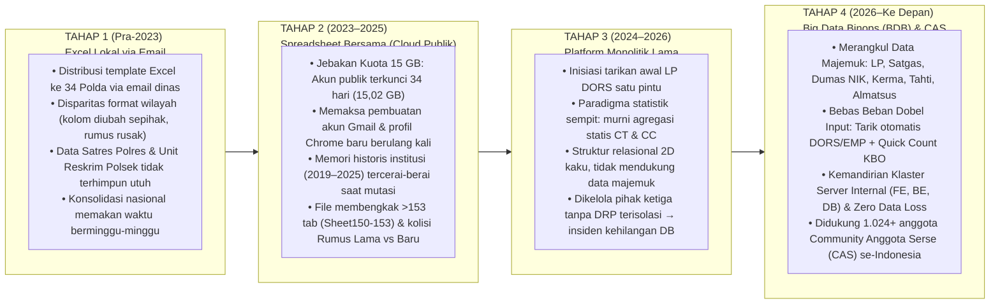
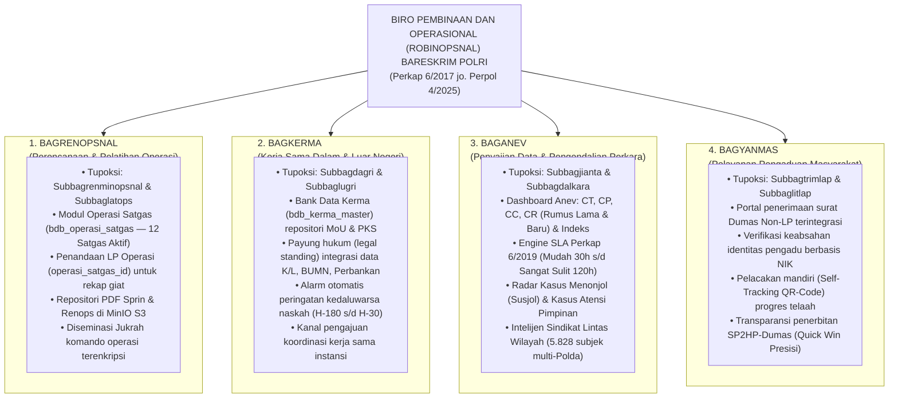
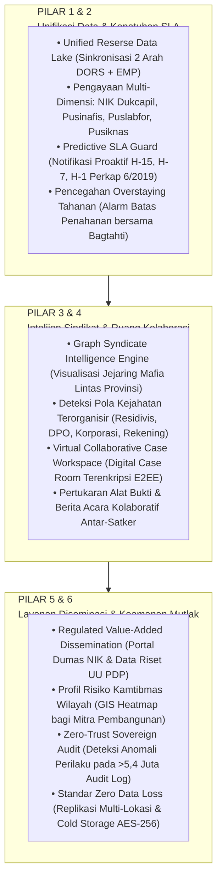

# Telaahan Strategis & Evolusi Arsitektur: Penguatan Tata Kelola Data Operasional — Big Data Binops (BDB) & Community Anggota Serse (CAS)

> **Konteks Dokumen:** Rangkuman Arsitektur Strategis & Evaluasi Empiris Sistem Berjalan (*Version 2.5 • T.A. 2026*)  
> **Lingkup Organisasi:** Biro Pembinaan dan Operasional (**Robinopsnal**) Bareskrim Polri & Jajaran Reserse Kewilayahan (Mabes Polri, 36 Polda, 508+ Polres, 4.900+ Polsek)  
> **Paradigma Platform:** **Big Data Binops (BDB)** sebagai ekosistem pengolahan data majemuk terpadu, yang digerakkan dari bawah (*bottom-up*) oleh **CAS (*Community Anggota Serse*)** — komunitas operasional aktif beranggotakan **1.024+ personil Reserse & Kaur Binops (KBO)** seluruh Indonesia.

---

## 1. Transformasi Identitas: Dari *Community Anggota Serse* Menuju *Community Anggota Serse (CAS)* & *Big Data Binops (BDB)*

Pada fase awal (2024–2025), akronim **CAS** merujuk pada sistem manual statis yang hanya berfokus sempit pada rekapitulasi angka *Crime Total (CT)* dan *Crime Clearance (CC)*. Seiring transformasi menyeluruh pada T.A. 2026:

1. **CAS (*Community Anggota Serse*)**: Bertransformasi menjadi gerakan dan komunitas organik berkapasitas penuh (**1.024 anggota aktif di grup komunikasi taktis WhatsApp & ribuan pengguna aktif di kanal internal SHARESE**) yang mempertemukan penyidik, operator, Kanit Reskrim Polsek, hingga KBO Satreskrim/Ditreskrim se-Indonesia. Komunitas ini menjadi *feedback loop* langsung untuk mendeteksi kendala lapangan, merumuskan kebutuhan fitur nyata, dan mengawal kepatuhan data secara *real-time*.
2. **BDB (*Big Data Binops*)**: Merupakan nama resmi platform teknologi generasi ke-4 yang lahir dari kebutuhan **Community Anggota Serse (CAS)** dan **4 Bagian Inti Robinopsnal Bareskrim Polri** untuk mengelola kemajemukan data operasional (*Laporan Polisi, Operasi Satgas, Naskah Kerja Sama MoU/PKS, Pengaduan Masyarakat Non-LP, Register Tahanan/Tahti, Barang Bukti, dan Almatsus*) secara mandiri dan berdaulat.

---

## 2. Kronologi Evolusi 4 Tahapan Pendataan Operasional

Perjalanan rekayasa sistem ini berangkat dari pengalaman langsung sebagai **Analis Data Operasional** yang menghadapi kerapuhan pengelolaan data manual sebelum membangun arsitektur **Full-Stack Big Data Binops (BDB)**:

### Fakta Empiris Kerapuhan Pra-Sistem yang Diselesaikan oleh BDB:
- **Jebakan Kuota 15 GB & Fragmentasi Akun Publik**: Sebelum BDB, penyimpanan cloud publik mencapai `15,02 GB` dari batas `15 GB` dan terkunci selama 34 hari, memaksa staf membuat banyak akun baru dan memelihara puluhan profil peramban terpisah yang memecah sejarah data institusi.
- **Ledakan Ratusan Tab Spreadsheet & Kolisi Input**: Satu berkas spreadsheet nasional membengkak hingga `Sheet150–Sheet153` dengan bentrokan pengisian antar-satgas serta dualisme rumus penyelesaian perkara (*Rumus Lama vs Rumus Baru*).
- **Tingginya Permintaan Data Komando Mendadak**: Puluhan Nota Dinas resmi pimpinan (Rilis Akhir Tahun, Anev Semesteran, Satgas Pangan, TPPO, Judi Online, Restorative Justice, dll.) sebelumnya harus dikompulir manual melalui tautan pendek dan pesan singkat yang memakan waktu berhari-hari.

---

## 3. Prinsip Kerja & Keunggulan Fungsional bagi Petugas Lapangan

Big Data Binops (BDB) dirancang dengan filosofi **"Mengoptimalkan instrumen kerja yang sudah ada tanpa menambah beban pengisian administratif ganda bagi penyidik di lapangan"**:

1. **Penyeragaman Format & Pengakhiran Silo Data (*Single Source of Truth*)**:
   - Menghapus ketergantungan pada puluhan spreadsheet manual; konsolidasi data dari tingkat **Unit Reskrim Polsek $\to$ Satreskrim Polres $\to$ Ditreskrim Polda $\to$ Bareskrim Polri** berjalan otomatis.
2. **Instrumen Anev Lintas Sumber & Deteksi Perkara Macet (*Bottleneck Detection*)**:
   - **Bebas Dobel Input**: Apabila instrumen kerja primer penyidik (DORS / EMP) telah diisi dengan benar, BDB menarik dan menormalisasi datanya secara otomatis untuk kebutuhan Anev pimpinan.
   - **Riwayat Lancar sebagai Nilai Plus**: LP yang riwayat administrasi penyidikannya tuntas dari awal hingga akhir tercatat otomatis sebagai capaian kinerja positif.
   - **Deteksi Hambatan & Asistensi KBO**: Sistem mendeteksi nomor LP yang melewati ambang batas SLA atau macet administrasinya sehingga Kaur Binops (KBO) dapat langsung melakukan pembinaan terarah.
3. **Lapor Cepat KBO (*Quick Count Operasional*)**:
   - Memfasilitasi KBO dan unsur taktis lapangan (*Satresmob*) untuk mencatat giat penindakan/upaya paksa mendesak saat penyidik masih bertugas di luar daerah sebelum sempat memperbarui administrasi lengkap.

---

## 4. Bukti Riil Kecepatan Rekonsiliasi & Audit Matematis (Kasus Operasional 2026)

| Studi Kasus Lapangan | Tantangan Sebelumnya | Penyelesaian Arsitektural di Big Data Binops (BDB) |
| :--- | :--- | :--- |
| **Kasus 1: Rekonsiliasi Presisi Selisih 8 LP pada Persiapan Audiensi Pimpinan (2026)** | Tarikan awal DORS mencatat `1.728 LP`, sedangkan rekap manual direktorat mencatat `1.720 LP` (selisih `8 LP` akibat berkas fisik di Polda sedang berproses namun sinkronisasi administrasi pusat belum tersambung). | Engine rekonsiliasi matematis multi-sumber (`bdb_dors_raw_lp` $\leftrightarrow$ `bdb_laporan_polisi` $\leftrightarrow$ `bdb_lp_pelimpahan`) mengisolasi ke-8 LP tersebut dalam hitungan menit tanpa menyisakan selisih angka. |
| **Kasus 2: Pelacakan Instan DPO Lintas Negara & Koordinasi Ekstradisi** | Saat pimpinan menanyakan posisi spesifik buronan atensi trans-nasional, petugas harus menghubungi penyidik satu per satu dan membongkar arsip fisik. | Keterhubungan langsung antara nomor LP, status tersangka/DPO (`bdb_dpo`), *Red Notice*, dan riwayat penanganan tersaji instan di layar komando. |
| **Kasus 3: Audit Matematis 100% Terverifikasi pada 36 Polda & Bareskrim** | Perbedaan klasifikasi kejahatan dan pemekaran satker membuat angka agregat wilayah vs pusat sering tidak sinkron. | Lolos verifikasi audit matematis 100% lintas **36 Polda (`269.436 CT`) + Bareskrim (`623 CT`) = `270.059 CT` Nasional** (termasuk konsolidasi presisi 7 Sub-Tipid seperti `Tipidum 199.121 + Tipid PPA-PPO 21.024 = 220.145 Ditreskrimum`). |

---

## 5. Keselarasan Penuh dengan SOTK Polri (`Perkap 6/2017 jo. Perpol 4/2025`)

### 5.1. Implementasi Tata Kelola Data pada 4 Bagian Inti Robinopsnal Bareskrim Polri

### 5.2. Sentralitas Binops Reserse & Pemisahan Tegas Fungsi Non-Reserse
Arsitektur `bdb_satker` dan view `bdb_satker_taxonomy_r11` memisahkan secara ketat rantai komando **Korps Reserse (Internal Reserse — Memiliki Struktur KBO)** dari fungsi **Non-Reserse (Eksternal Reserse)**:

| Tingkat Wilayah | Unsur Korps Reserse (`INTERNAL_RESERSE` — Masuk Kinerja Reserse) | Unsur Non-Reserse / Eksternal (`EKSTERNAL_RESERSE` — Dipisahkan Kamarnya) |
| :--- | :--- | :--- |
| **Mabes Polri** | **Bareskrim Polri** (Robinopsnal, Rorenmin/Bagtahti, Rowassidik, Rokorwas PPNS, **6 Direktorat Teknis**: *Dittipidum, Dittipideksus, Dittipidter, Dittipidnarkoba, Dittipidsiber, Dittipid PPA-PPO*, **3 Pusat**: *Puslabfor, Pusiknas, Pusinafis*, serta unsur taktis **Satresmob**) | **Baharkam** (*Korpolairud/Ditpolairud, Sabhara, Binmas*), **Korlantas**, **Baintelkam**, **Kortastipidkor** (*mandiri di bawah Kapolri sesuai Pasal 20 huruf c1 Perpol 4/2025*), **Densus 88 AT** |
| **Polda (36 Polda)** | **5 Direktorat Reserse** (dipimpin oleh *Kabagbinopsnal*): **Ditreskrimum, Ditreskrimsus, Ditresnarkoba, Ditressiber, dan Ditres PPA-PPO** | *Ditpolairud, Ditsamapta, Ditlantas, Ditbinmas, Ditpamobvit, Ditintelkam* |
| **Polres (508+ Polres)** | **Satreskrim, Satresnarkoba, dan Satres PPA-PPO** (*satker pemekaran baru sesuai Perpol 4/2025*, masing-masing dikendalikan oleh **KBO**) | *Satpolairud, Satsamapta, Satlantas, Satbinmas, Satintelkam* |
| **Polsek (4.900+ Polsek)** | **Unit Reskrim Polsek** (*Urminops* sebagai pelapor & penyidik awal di lini terdepan, terintegrasi satu kesatuan dengan induk Polsek) | *Unit Lantas, Unit Samapta/Sabhara, Unit Binmas, Unit Intelkam* |

---

## 6. Arsitektur Live Basis Data BDB dalam 4 Klaster Fungsional Berdaya Tahan Tinggi

Audit teknis pada database produksi PostgreSQL membuktikan tata kelola data yang terbagi ke dalam **4 Klaster Fungsional Utama**:

### Klaster 1 — Ingesti DORS & Core LP (*Pondasi Data Utama*)
- **Decoupled JSONB Staging (`bdb_dors_raw_lp` & `bdb_dors_lp` — 2,85+ Juta Baris)**: Menyimpan *raw payload* JSONB dari DORS Stamaops Polri secara utuh tanpa risiko merusak data hulu saat rekonsiliasi.
- **Normalized Core LP (`bdb_laporan_polisi` — 2,84+ Juta Baris)**: Termutakhirkan secara presisi ke **14.217 node Satker**.
- **Sanitasi Anomali Karakter Gaib (`chr(160)` / NBSP)**: Membersihkan karakter *Non-Breaking Space* pada `kode_pusiknas` menggunakan `REGEXP_REPLACE` sehingga pencocokan hierarki satker 100% akurat.
- **Siklus Hidup KUHAP (11 Status Penanganan)**: Memisahkan dengan tegas **7 Status Beban Kasus (CT / Crime Process)** dari **4 Status Penyelesaian Perkara (CC: *Tahap II, SP3, RJ, SP2Lid*)**, dengan menerapkan doktrin yuridis ketat bahwa **Status P-21 tetap terhitung beban CT hingga penyerahan fisik tersangka & barang bukti (Tahap II)**.

### Klaster 2 — Taktis, Operasi Satgas & MinIO S3 Object Storage
- **Multi-LP Bridge**: Menghubungkan ratusan **Kasus Menonjol (`bdb_kasus_menonjol`)** dan **Kasus Atensi Pimpinan (`bdb_kasus_atensi`)** yang memayungi banyak Laporan Polisi lintas satker.
- **Operasi Satgas (`bdb_operasi_satgas`) & Bank Data Kerma (`bdb_kerma_master`)**: Mengikat LP langsung ke operasi kepolisian aktif serta memantau masa berlaku MoU/PKS dengan alarm otomatis `H-180` s/d `H-30`.
- **MinIO S3 Dual-Client Pattern (Port `9100`/`9101`)**: Menyimpan dokumen biner PDF (*Sprin, Renops, Naskah Kerma, Lampiran*) di luar tabel PostgreSQL (*zero database bloat*), dengan pemisahan endpoint internal dan *presigned URL* publik.
- **Placement & Transfer Guard (`bdb_lp_pelimpahan` — 2.590+ Perkara)**: Mengunci mutasi pelimpahan 1 level dan menjaga rekam jejak *read-only* pada satker asal.

### Klaster 3 — Engine Analitik Kinerja, SLA Perkap 6/2019 & Intelijen Sindikat
- **Pre-Computed Materialized Snapshot (`bdb_kinerja_perkara_snapshot` — 2,11+ Juta Baris)**: Memangkas waktu eksekusi kueri agregasi nasional dari **$>10\text{ detik}$ menjadi $<100\text{ milidetik}$**, sekaligus mengeliminasi lonjakan CPU (*CPU spike*) saat jam sibuk evaluasi komando.
- **Engine SLA SOP Perkap 6/2019**: Menghitung otomatis batas waktu penanganan perkara berdasarkan tingkat kesulitan (*Mudah 30 hari, Sedang 60 hari, Sulit 90 hari, Sangat Sulit 120 hari*).
- **Intelijen Sindikat Lintas Wilayah (`bdb_pihak_terlibat_ranking_snapshot`)**: Mengidentifikasi dan memberi bobot skor nasional (`nasional_score`) terhadap **5.828+ subjek hukum/sindikat** (`is_lintas_wilayah`) yang beraksi di lebih dari satu wilayah Polda, termasuk pemetaan korporasi terlapor berulang.

### Klaster 4 — Komando Taktis SHARESE & Forensic Audit Trail
- **SHARESE Berorientasi Perkara (`bdb_social_posts` & `bdb_jukrah`)**: Forum komunikasi taktis internal penyidik yang dapat mengikat diskusi langsung ke nomor LP (`case_lp_ids`), tagar operasional (`#ModusOperandi`, `#DPO`, `#Sindikat`), serta menyematkan *Jukrah & Atensi Pimpinan* di posisi teratas sesuai satker target.
- **Forensic Audit Trail (`bdb_audit_log` — 5,46+ Juta Rekaman Live)**: Mencatat secara otomatis setiap interaksi penegakan hukum (*User ID, IP Address, Action, Entity, dan JSONB Metadata*) guna menjamin akuntabilitas penyidikan dan mencegah kebocoran dokumen peradilan pidana.

---

## 7. Cetak Biru 6 Pilar Transformasi & Roadmap Menuju Kedaulatan Data 2045

### Pentahapan Roadmap Implementasi:
1. **Waktu Dekat (*Penguatan Eksisting*)**: Stabilisasi klaster server internal (FE, BE, DB), penyempurnaan integrasi tarikan LP DORS-EMP & pemetaan >357 ribu LP tahun berjalan, serta penguatan forum taktis **SHARESE** & komunitas **CAS (*Community Anggota Serse*)**.
2. **Jangka Pendek (*Mendukung Quick Wins Presisi*)**: Standarisasi format laporan kewilayahan, aktivasi portal publik terpisah (pelacakan mandiri Dumas via NIK & QR-Code), uji coba instrumen *Lapor Cepat KBO (Quick Count)*, dan modul deteksi perkara macet.
3. **Jangka Menengah (*Menuju Polri Emas*)**: Asisten analitik cerdas untuk interpretasi naratif instan pimpinan, integrasi inventarisasi Personel, *Almatsus*, *Tahti* (monitoring tahanan nasional & pencegahan *overstaying*), Register Barang Bukti, serta layanan permohonan data riset akademisi.
4. **Jangka Panjang (*Kedaulatan Data Indonesia Emas 2045*)**: Visualisasi spasial *GIS Crime Heatmap* nasional, *Predictive Policing*, dan ekosistem Big Data penegakan hukum yang mandiri serta berdaulat penuh.
