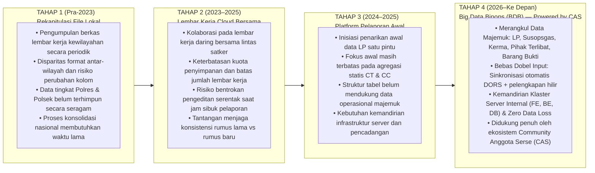
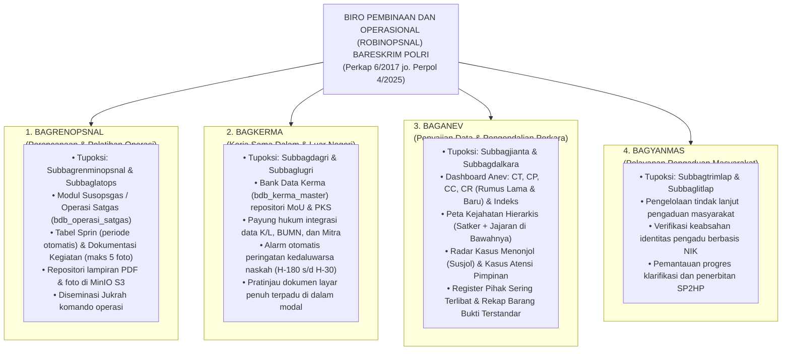
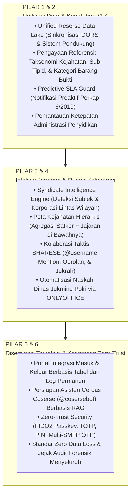

# Telaahan Strategis & Evolusi Arsitektur: Penguatan Tata Kelola Data Operasional — Big Data Binops (BDB) & Community Anggota Serse (CAS)

> **Konteks Dokumen:** Rangkuman Arsitektur Strategis & Evaluasi Sistem Berjalan (*Version 2.6 • November 2026*)  
> **Lingkup Organisasi:** Biro Pembinaan dan Operasional (**Robinopsnal**) Bareskrim Polri & Jajaran Reserse Kewilayahan (Mabes Polri, 36 Polda, Polres, dan Polsek)  
> **Paradigma Platform:** **Big Data Binops (BDB)** sebagai ekosistem pengolahan data majemuk terpadu, yang digerakkan bersama **CAS (*Community Anggota Serse*)** — komunitas operasional penyidik, operator, Kanit Reskrim, dan Kaur Binops (KBO) di seluruh Indonesia.

---

## 1. Transformasi Identitas: *Big Data Binops (BDB) — Powered by CAS (Community Anggota Serse)*

Seiring modernisasi tata kelola data operasional kepolisian pada T.A. 2026:

1. **CAS (*Community Anggota Serse*)**: Merupakan komunitas operasional aktif yang mempertemukan penyidik, operator, Kanit Reskrim Polsek, hingga KBO Satreskrim/Ditreskrim se-Indonesia. Komunitas ini menjadi *feedback loop* langsung melalui kanal internal **SHARESE** untuk mendeteksi kendala lapangan, merumuskan kebutuhan fitur nyata, dan mengawal kepatuhan data secara *real-time*.
2. **BDB (*Big Data Binops*)**: Merupakan platform teknologi generasi ke-4 yang dirancang untuk mendukung **4 Bagian Inti Robinopsnal Bareskrim Polri** dalam mengelola kemajemukan data operasional (*Laporan Polisi, Susopsgas / Operasi Satgas, Naskah Kerja Sama MoU/PKS, Pengaduan Masyarakat Non-LP, Pihak Terlibat, dan Barang Bukti*) secara terpusat dan terstandarisasi.

---

## 2. Kronologi Evolusi 4 Tahapan Pendataan Operasional

Perjalanan rekayasa sistem ini bertransformasi melalui empat tahapan utama menuju arsitektur **Full-Stack Big Data Binops (BDB)**:

---

## 3. Prinsip Kerja & Keunggulan Fungsional bagi Petugas Lapangan

Big Data Binops (BDB) dirancang dengan filosofi **"Mengoptimalkan instrumen kerja yang sudah ada tanpa menambah beban pengisian administratif ganda bagi penyidik di lapangan"**:

1. **Penyeragaman Format & Pengakhiran Silo Data (*Single Source of Truth*)**:
   - Menghapus ketergantungan pada rekapitulasi manual; konsolidasi data dari tingkat **Unit Reskrim Polsek → Satreskrim Polres → Ditreskrim Polda → Bareskrim Polri** berjalan otomatis dengan nomenklatur singkatan satuan kerja yang seragam (`DITKRIMUM`, `DITKRIMSUS`, `DITNARKOBA`, `DITPPA-PPO`, `DITSIBER`, `SATRESKRIM`).
2. **Instrumen Anev Lintas Sumber & Proteksi Provenans Data Hulu**:
   - **Bebas Dobel Input**: Data Laporan Polisi yang telah diinput pada sistem hulu (**DORS Stamaops Polri**) ditarik dan dinormalisasi secara otomatis untuk kebutuhan Anev pimpinan.
   - **Proteksi Provenans (`Edit-Only / No-Delete`)**: Data yang bersumber dari DORS dilindungi agar tidak dapat dihapus di hilir, namun tetap dapat dilengkapi atribut pendukungnya (seperti satuan barang bukti atau progres dokumen penyidikan).
   - **Deteksi Hambatan & Asistensi KBO**: Sistem mendeteksi nomor LP yang melewati ambang batas SLA sehingga Kaur Binops (KBO) dapat melakukan pembinaan secara terarah.

---

## 4. Keunggulan Rekonsiliasi & Ketepatan Analitik

| Aspek Operasional | Tantangan Sebelumnya | Penyelesaian Arsitektural di Big Data Binops (BDB) |
| :--- | :--- | :--- |
| **Rekonsiliasi Lintas Tingkat Kewilayahan** | Perbedaan penulisan nama satker dan proses pelimpahan berkas antar-satker sering memicu selisih rekapitulasi antara wilayah dan pusat. | Engine rekonsiliasi multi-sumber (`bdb_dors_raw_lp` ↔ `bdb_laporan_polisi` ↔ `bdb_lp_pelimpahan`) menyelaraskan penempatan satker dan mengisolasi LP yang belum termapping secara presisi. |
| **Pelacakan Subjek Berulang & DPO Lintas Wilayah** | Penelusuran keterlibatan subjek yang sama di beberapa Polda membutuhkan koordinasi manual antar-penyidik. | Keterhubungan langsung antara nomor LP, indeks NIK/Korporasi (`bdb_pihak_terlibat_ranking_snapshot`), dan status DPO (`bdb_dpo`) tersaji instan di layar komando. |
| **Konsistensi Taksonomi Kejahatan & Sub-Tipid** | Variasi pengelompokan jenis kejahatan membuat agregasi antar-direktorat sulit dibandingkan secara apel-ke-apel. | Standarisasi kamus **Kelompok Kejahatan** (`KRIMUM`, `KRIMSUS`, `NARKOBA`, `PPA-PPO`, `SIBER`) dan **Sub-Kelompok Tipid** (`TIPIDUM`, `TIPIDEKSUS`, `TIPIDKOR`, `TIPIDTER`, `TIPIDNARKOBA`, `TIPIDPPA-PPO`, `TIPIDSIBER`) di seluruh modul laporan dan peta kejahatan. |

---

## 5. Keselarasan Penuh dengan SOTK Polri (`Perkap 6/2017 jo. Perpol 4/2025`)

### 5.1. Implementasi Tata Kelola Data pada 4 Bagian Inti Robinopsnal Bareskrim Polri

### 5.2. Sentralitas Binops Reserse & Pemisahan Tegas Fungsi Non-Reserse
Arsitektur `bdb_satker` dan view `bdb_satker_taxonomy_r11` memisahkan secara ketat rantai komando **Korps Reserse (`INTERNAL_RESERSE`)** dari fungsi **Non-Reserse (`EKSTERNAL_RESERSE`)**:

| Tingkat Wilayah | Unsur Korps Reserse (`INTERNAL_RESERSE` — Masuk Kinerja Reserse) | Unsur Non-Reserse / Eksternal (`EKSTERNAL_RESERSE` — Dipisahkan Kamarnya) |
| :--- | :--- | :--- |
| **Mabes Polri** | **Bareskrim Polri** (Robinopsnal, Rorenmin/Bagtahti, Rowassidik, Rokorwas PPNS, **Direktorat Teknis**: *Dittipidum, Dittipideksus, Dittipidter, Dittipidnarkoba, Dittipidsiber, Dittipid PPA-PPO*, **Pusat**: *Puslabfor, Pusiknas, Pusinafis*, serta unsur taktis **Satresmob**) | **Baharkam** (*Korpolairud/Ditpolairud, Sabhara, Binmas*), **Korlantas**, **Baintelkam**, **Kortastipidkor**, **Densus 88 AT** |
| **Polda (36 Polda)** | **5 Direktorat Reserse** (`DITKRIMUM`, `DITKRIMSUS`, `DITNARKOBA`, `DITSIBER`, dan `DITPPA-PPO`) | *Ditpolairud, Ditsamapta, Ditlantas, Ditbinmas, Ditpamobvit, Ditintelkam* |
| **Polres** | **Satreskrim, Satresnarkoba, dan Satres PPA-PPO** (*satker pemekaran sesuai Perpol 4/2025*, masing-masing dikendalikan oleh **KBO**) | *Satpolairud, Satsamapta, Satlantas, Satbinmas, Satintelkam* |
| **Polsek** | **Unit Reskrim Polsek** (*terintegrasi satu kesatuan cakupan dengan induk Polsek*) | *Unit Lantas, Unit Samapta/Sabhara, Unit Binmas, Unit Intelkam* |

---

## 6. Arsitektur Basis Data BDB dalam 4 Klaster Fungsional

Database produksi PostgreSQL dikelola ke dalam **4 Klaster Fungsional Utama**:

### Klaster 1 — Ingesti DORS & Core LP (*Pondasi Data Utama*)
- **Decoupled JSONB Staging (`bdb_dors_raw_lp` & `bdb_dors_lp`)**: Menyimpan *raw payload* JSONB dari DORS Stamaops Polri secara utuh tanpa risiko merusak data hulu saat rekonsiliasi.
- **Normalized Core LP (`bdb_laporan_polisi`)**: Termutakhirkan secara presisi ke pohon hierarki `bdb_satker`.
- **Sanitasi Karakter Spasi (`chr(160)` / NBSP)**: Membersihkan karakter *Non-Breaking Space* pada kode referensi menggunakan `REGEXP_REPLACE` sehingga pencocokan hierarki satker selalu akurat.
- **Siklus Hidup KUHAP (11 Status Penanganan)**: Memisahkan **Status Beban Kasus (CT / Crime Process)** dari **Status Penyelesaian Perkara (CC: *Tahap II, SP3, RJ, SP2Lid, PERMA*)**, dengan menerapkan doktrin yuridis bahwa **Status P-21 tetap terhitung beban CT hingga penyerahan fisik tersangka & barang bukti (Tahap II)**.

### Klaster 2 — Taktis, Susopsgas & MinIO S3 Object Storage
- **Multi-LP Bridge**: Menghubungkan **Kasus Menonjol (`bdb_kasus_menonjol`)** dan **Kasus Atensi Pimpinan (`bdb_kasus_atensi`)** yang memayungi banyak Laporan Polisi lintas satker.
- **Susopsgas (`bdb_operasi_satgas`) & Bank Data Kerma (`bdb_kerma_master`)**: Mengikat LP ke operasi kepolisian aktif, mencatat tabel Sprin dan dokumentasi giat, serta memantau masa berlaku MoU/PKS dengan alarm otomatis `H-180` s/d `H-30`.
- **MinIO S3 Dual-Client Pattern (Port `9100`/`9101`)**: Menyimpan dokumen biner PDF dan foto di luar tabel PostgreSQL (*zero database bloat*).

### Klaster 3 — Engine Analitik Kinerja, Fast Cache & Intelijen Subjek Berulang
- **Pre-Computed Materialized Snapshot & Fast Cache (`bdb_kinerja_perkara_snapshot`, `bdb_anev_dashboard_snapshot`, `bdb_pihak_terlibat_fast_cache`)**: Memangkas waktu eksekusi kueri agregasi nasional dan filter register menjadi **`< 20–100 milidetik`**.
- **Engine SLA SOP Perkap 6/2019**: Menghitung otomatis batas waktu penanganan perkara berdasarkan tingkat kesulitan (*Mudah 30 hari, Sedang 60 hari, Sulit 90 hari, Sangat Sulit 120 hari*).
- **Pihak Sering Terlibat (`bdb_pihak_terlibat_ranking_snapshot`)**: Mengidentifikasi subjek hukum dan korporasi yang tercatat berulang kali lintas wilayah Polda.

### Klaster 4 — Komando Taktis SHARESE, Tata Kelola Pengguna & Forensic Audit Trail
- **SHARESE Berorientasi Perkara (`bdb_social_posts` & `bdb_jukrah`)**: Forum komunikasi taktis internal penyidik dengan fitur *autocomplete* `@username`, pengikatan nomor LP (`case_lp_ids`), obrolan langsung, serta penyematan *Jukrah & Atensi Pimpinan*.
- **Skor Keaktifan Kombinasi & Manajemen Role**: Mengukur keaktifan personel dari kombinasi **frekuensi hari login dalam 30 hari terakhir** dan **rata-rata durasi sesi login**, mengalihkan akun pasif ke role **`sharese`**, serta menyediakan role **`testing`** (*Read-Only*) untuk keperluan peninjauan mitra/vendor.
- **Forensic Audit Trail (`bdb_audit_log`)**: Mencatat setiap interaksi pengguna (*User ID, IP Address, Action, Entity, dan JSONB Metadata*) guna menjamin akuntabilitas penuh.

---

## 7. Cetak Biru 6 Pilar Transformasi & Roadmap Pengembangan

