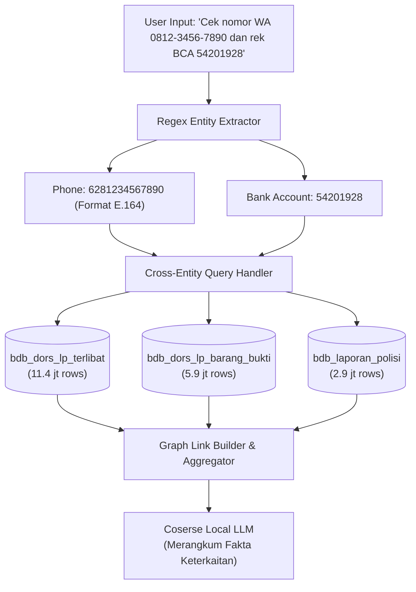

# SPESIFIKASI MULTI-ENTITY CROSS-PROFILING & INTELLIGENCE DATA RESOLUTION
## Modul Coserse (AI Agent Bareskrim Polri)

> **File**: `docs/coserse_blueprint/03_CROSS_PROFILING_AND_DATA_SPEC.md`  
> **Klasifikasi**: INTELIJEN / ANALITIK TERBATAS  
> **Volume Database**: 11,4 Juta Pihak Terlibat + 5,9 Juta Barang Bukti  
> **Tanggal**: November 2026  

---

## 1. Latar Belakang & Kebutuhan Lapangan
Pelaku kejahatan atau sindikat (terutama penipuan online, TPPO, narkoba, mafia tanah, dan pencucian uang) jarang menggunakan satu identitas NIK asli yang konsisten. Kerap kali keterlibatan mereka di berbagai Laporan Polisi (LP) hanya dapat dihubungkan melalui:
- **Nomor Handphone / WhatsApp**
- **Nomor Rekening Bank & Nama Buku Tabungan**
- **Akun Media Sosial / Username Telegram / Email**
- **Nomor Polisi Kendaraan / Nomor Rangka / IMEI Barang Bukti**
- **Pola Modus Operandi & Lokasi Kejadian**

Coserse bertindak sebagai **Mesin Pengurai Benang Merah (Entity Resolution Engine)** yang menghubungkan data lintas wilayah secara instan.

---

## 2. Struktur Sumber Data Database BDB

### 2.1 Entitas Pihak Terlibat (`bdb_dors_lp_terlibat`) &mdash; 11.470.497 Baris
Kolom kunci yang dipetakan oleh Coserse:
- `nama`: Nama lengkap atau nama alias.
- `nik`: Nomor Induk Kependudukan (16 digit).
- `jenis_identitas`: KTP, SIM, Paspor, atau KTA.
- `alamat`, `pekerjaan`, `tgl_lahir`, `tempat_lahir`.
- `lp_id`: Relasi langsung ke induk berkas perkara (`bdb_laporan_polisi`).

### 2.2 Entitas Barang Bukti (`bdb_dors_lp_barang_bukti`) &mdash; 5.906.553 Baris
Kolom kunci yang dipetakan oleh Coserse:
- `keterangan`: Berisi teks mentah nomor rekening (misal *"BCA 82910xxxx a.n. John"*), nomor telepon seluler, IMEI, link transaksi kripto, atau URL akun medsos.
- `jenis_bb`: Kategori (Handphone, Rekening Bank, Dokumen, Kendaraan, Senpi dsb.).
- `ran_nopol`, `ran_merk`, `ran_warna`: Data kendaraan bermotor.

---

## 3. Skema Normalisasi & Tokenisasi Entitas (Backend Service)

Saat penyidik mengetikkan pertanyaan bebas di Coserse, sistem menjalankan **Regex Pre-Parser** sebelum query dieksekusi:



---

## 4. Query PostgreSQL Teroptimasi (Indeks & Performa Tinggi)

Untuk memastikan pencarian pada 11,4 juta baris selesai dalam waktu **kurang dari 1,5 detik**:

### 4.1 Pencarian Multi-Parameter (Function Definition)
```sql
-- Query pencarian entitas orang berdasarkan NIK, Nama, atau No Telepon
CREATE OR REPLACE FUNCTION coserse_search_person_involvement(
    p_keyword TEXT,
    p_satker_scope TEXT DEFAULT NULL
)
RETURNS TABLE (
    lp_id BIGINT,
    no_laporan TEXT,
    tgl_laporan DATE,
    satker_nama TEXT,
    nama_terlibat TEXT,
    nik_terlibat TEXT,
    peran TEXT,
    jenis_kejahatan TEXT,
    status_lp TEXT,
    keterangan_bb TEXT
) AS $$
BEGIN
    RETURN QUERY
    SELECT 
        lp.id AS lp_id,
        lp.no_laporan,
        lp.tgl_laporan,
        lp.satker_nama,
        ter.nama AS nama_terlibat,
        ter.nik AS nik_terlibat,
        COALESCE(ter.model_lp, 'TERLIBAT') AS peran,
        COALESCE(lp.kategori, '-') AS jenis_kejahatan,
        COALESCE(sm.nama, 'Belum Update') AS status_lp,
        bb.keterangan AS keterangan_bb
    FROM bdb_dors_lp_terlibat ter
    JOIN bdb_laporan_polisi lp ON lp.id = ter.lp_id
    LEFT JOIN bdb_status_master sm ON sm.id = lp.status_id
    LEFT JOIN bdb_dors_lp_barang_bukti bb ON bb.lp_id = lp.id 
         AND (bb.keterangan ILIKE '%' || p_keyword || '%')
    WHERE 
        (ter.nik = p_keyword OR ter.nama ILIKE '%' || p_keyword || '%' OR bb.keterangan ILIKE '%' || p_keyword || '%')
        AND lp.deleted_at IS NULL
    ORDER BY lp.tgl_laporan DESC
    LIMIT 25;
END;
$$ LANGUAGE plpgsql;
```

---

## 5. Standar Format Output Jawaban Coserse ke Penyidik

Model LLM diwajibkan menyajikan hasil penelusuran dalam format terstruktur yang mudah dipahami penyidik lapangan:

```markdown
### 🔍 HASIL PENELUSURAN IDENTITAS: "0812-3456-7890" (atau NIK: 317101xxxxxx)

Ditemukan keterkaitan pada **3 Laporan Polisi (LP)** di wilayah hukum berbeda:

| No | Nomor Laporan Polisi | Tanggal | Satuan Kerja | Peran / Keterkaitan | Status Perkara |
|---|---|---|---|---|---|
| 1 | **LP/B/142/IV/2026/SPKT/POLDA METRO JAYA** | 12-04-2026 | Ditreskrimsus | **Terlapor / Tersangka** (Penipuan Online) | Tahap II |
| 2 | **LP/A/88/VIII/2026/RES BOGOR** | 05-08-2026 | Satreskrim | **Pemilik Rekening / Saksi Kunci** | Sidik |
| 3 | **LP/B/19/X/2026/POLSEK TANAH ABANG** | 20-10-2026 | Unit Reskrim | **Barang Bukti (HP Kontak Penadah)** | Penyelidikan |

💡 **Analisis Korelasi Coserse**:
- Profil yang sama terdeteksi berulang kali di wilayah Jabodetabek dalam kurun waktu 6 bulan terakhir.
- Rekening terafiliasi: **Bank BCA No. Rek 542019xxxx a.n. [Nama Samaran]**.
- Tombol Aksi: `[📂 Buka Rincian Perkara #1]` | `[📄 Ekspor Lembar Profiling PDF / Word Resmi]`

---

## 6. Fitur Ekspor Resume Profiling Resmi (PDF & Word Export)

Cosersebot menyediakan tombol instan **`[📄 Ekspor Lembar Profiling PDF / Word Resmi]`**:
1. **Format Ber-KOP Kedinasan**: Menghasilkan dokumen A4 siap cetak dengan KOP Robinopsnal Bareskrim Polri / Satker pengguna.
2. **Isi Lembar Resume**:
   - Parameter pencarian (Nama / NIK / No HP / Rekening).
   - Tabel keterkaitan LP (Nomor LP, tanggal, peran, pasal, satker penangan).
   - Timestamp penarikan data & operator yang meminta laporan.
3. **Catatan Kaki Baku di Bawah Dokumen**:
   > *"Coserse dapat melakukan kesalahan. Hanya untuk internal dan tolong periksa ulang hasil pekerjaan."*
4. Dokumen ini dapat langsung digunakan staf Binops sebagai bahan paparan anev periodik atau nota dinas telaah kepada pimpinan.
```
