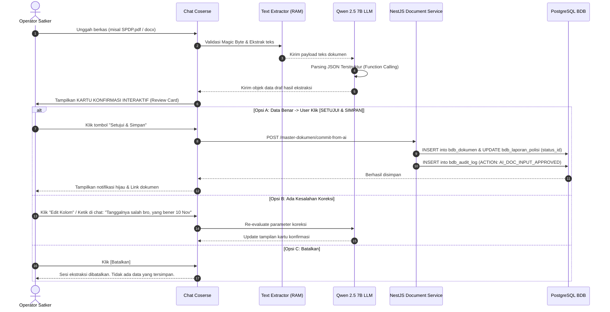

# MEKANISME EKSTRAKSI DOKUMEN MINDIK & HUMAN-IN-THE-LOOP INTERACTION
## Modul Coserse (AI Agent Bareskrim Polri)

> **File**: `docs/coserse_blueprint/04_DOCUMENT_PARSING_AND_HUMAN_IN_THE_LOOP.md`  
> **Klasifikasi**: TEKNIS & PROSEDUR OPERASIONAL STANDAR (SOP)  
> **Modul Terkait**: `bdb_dokumen`, `bdb_laporan_polisi`, `bdb_document_type_master`  
> **Tanggal**: November 2026  

---

## 1. Filosofi Desain: Mengapa Wajib Human-in-the-Loop?
Perubahan status perkara pidana (misal dari Lidik menjadi Sidik, atau Tahap II dan SP3) berdampak langsung pada status hukum seseorang (tersangka/terpidana) dan indikator kinerja Polri (Crime Clearance / CC).

**AI TIDAK BOLEH MEMILIKI AKSES TULIS LANGSUNG KE TABEL PRODUKSI.**  
AI hanya bertindak sebagai **"Juru Baca & Asisten Pembuat Draf"**, sedangkan penyidik/operator bertindak sebagai **"Pemberi Otorisasi Resmi"** melalui klik konfirmasi fisik di layar monitor.

---

## 2. Format Dokumen & Tiga Jalur Pengunggahan File (Input Channels)

Untuk kenyamanan staf Binops agar tidak kaku, antarmuka chat Cosersebot wajib mendukung **3 Jalur Input Berkas Modern**:
1. **Drag-and-Drop (Nyeret File Langsung)**: Staf cukup menyeret (*drag*) file dari Windows Explorer lalu menjatuhkannya (*drop*) ke area kotak obrolan. Area chat akan menampilkan overlay visual: *"Lepaskan berkas untuk dianalisis Coserse 1.0"*.
2. **Tombol Klip Unggah (File Picker Dialog)**: Ikon klip kertas (*attachment*) di samping kotak chat untuk memilih berkas Word/PDF secara manual.
3. **Paste Gambar Tangkapan Layar (Clipboard Paste - Ctrl+V)**: Staf yang sedang membuka scan surat atau foto dokumen cukup menekan `PrtScn` / Snipping Tool, lalu langsung `Ctrl+V` di kotak chat Coserse. Sistem otomatis menangkap blob gambar dari clipboard browser.

### 2.1 Format Dokumen Kepolisian yang Dikenali (Parser Targets)

Sistem Coserse dilatih mengenali dokumen standar administrasi penyidikan (Perkap No. 6 Tahun 2019):

| Kode Dokumen | Nama Dokumen Resmi | Target Status LP Baru | Entitas Utama yang Wajib Ditarik |
| :--- | :--- | :--- | :--- |
| `SP_LIDIK` | Surat Perintah Penyelidikan | `LIDIK` (ID: 2) | Nomor Surat, Tanggal Surat, Nama Personel Penyelidik, Nomor LP Rujukan |
| `SPDP` | Surat Pemberitahuan Dimulainya Penyidikan | `SPDP` (ID: 9) | Nomor SPDP, Tanggal Terbit, Kejaksaan Tujuan, Nama Tersangka |
| `SP_SIDIK` | Surat Perintah Penyidikan | `SIDIK` (ID: 3) | Nomor Sprin Sidik, Tanggal, Dasar LP |
| `TAHAP_1` | Surat Pengantar Berkas Perkara Tahap I | `TAHAP_I` (ID: 5) | Nomor Surat, Tanggal Penyerahan Berkas, JPU Penerima |
| `P21` | Pemberitahuan Berkas Lengkap (P-21) | `P21` (ID: 11) | Nomor Surat Kejaksaan, Tanggal P-21, Nama Jaksa |
| `TAHAP_2` | Pelimpahan Tersangka & Barang Bukti | `TAHAP_II` (ID: 6) | Nomor Berita Acara, Tanggal Tahap II, Daftar Tersangka & BB |
| `SP3` | Surat Perintah Penghentian Penyidikan | `SP3` (ID: 4) | Nomor SP3, Tanggal Ketetapan, Alasan Penghentian (Bukan TP / Kurang Bukti / Daluwarsa) |
| `SP2_LIDIK`| Penghentian Penyelidikan | `SP2_LID` (ID: 7) | Nomor Surat, Tanggal, Resume Gelar Perkara |

---

## 3. Alur Kerja Teknis: Unggah Berkas hingga Simpan DB



---

## 4. Tampilan Kartu Konfirmasi Interaktif (Mockup Format Chat)

Saat Coserse berhasil membaca dokumen, di dalam ruang chat akan muncul komponen widget visual (*Generative UI / Action Card*):

```text
+-------------------------------------------------------------------------------+
|  📄 DRAF DOKUMEN HASIL PEMBACAAN COSERSE                                      |
|  Status: Menunggu Persetujuan Operator                                        |
+-------------------------------------------------------------------------------+
|  Nomor LP Terkait   : LP/B/892/X/2026/SPKT/POLDA JABAR                        |
|  Jenis Dokumen      : Surat Penyerahan Tahap II (Tersangka & Barang Bukti)    |
|  Nomor Dokumen      : B/241/X/RES.1.24/2026/Ditreskrimum                      |
|  Tanggal Dokumen    : 28 Oktober 2026                                         |
|  Tersangka          : 1. AHMAD DANI (3201xxxx)                                |
|                       2. RIKI SUBAGJA (3204xxxx)                              |
|  Kejaksaan Tujuan   : Kejaksaan Negeri Kota Bandung                           |
|  Perubahan Status   : [TAHAP I]  ===>  [TAHAP II (CRIME CLEARANCE)]           |
+-------------------------------------------------------------------------------+
|                                                                               |
|   [  ✅ SETUJUI & SIMPAN KE DATABASE  ]      [  ✏️ KOREKSI  ]    [  ❌ BATAL  ] |
|                                                                               |
+-------------------------------------------------------------------------------+
```

## 7. Fitur Akselerasi & Pengalaman Staf Binops (UX Enhancements)

### 7.1 Tombol Pill Saran Cepat (Quick Prompt Pills)
Di bagian atas kotak ketik chat Cosersebot, disediakan chip tombol cepat agar staf operator tidak perlu mengetik panjang dari nol:
- `[🔍 Profiling NIK / No HP]` &rarr; Otomatis mengisi prompt: *"Tolong bantu profiling nomor HP / NIK berikut: "*
- `[📄 Upload Berkas Mindik]` &rarr; Membuka dialog file picker untuk Word/PDF.
- `[📊 Cek Kinerja Selra Satker]` &rarr; Otomatis memicu evaluasi Crime Total, Crime Clearance, dan Clearance Rate satker.
- `[⚖️ Konsultasi Pasal UU 1/2023]` &rarr; Menanyakan rujukan padanan pasal KUHP baru.

### 7.2 Integrasi Notifikasi Lonceng Real-Time (`bdb_social_notifications`)
Saat dokumen mindik berhasil disimpan atau saat Superadmin selesai melakukan perbaikan LP nyasar:
- Cosersebot otomatis mengirimkan notifikasi dinas ke lonceng akun terkait (`bdb_social_notifications`):
  > *"🔔 **@cosersebot**: Berkas LP nomor [Nomor LP] berhasil diperbarui ke status Tahap II."*
- Staf dan pimpinan satker langsung mengetahui perubahan status tanpa harus merefresh halaman berkali-kali.

### 7.3 Catatan Kaki Wajib (Disclaimer)
Di bawah setiap kartu jawaban atau dialog draf:
> *"Coserse dapat melakukan kesalahan. Hanya untuk internal dan tolong periksa ulang hasil pekerjaan."*

---

## 8. Fitur Remediasi Data: Perbaikan LP Nyasar / Salah Kamar (Superadmin Only)

Selain membaca berkas baru, Coserse dilengkapi kemampuan **Data Remediation Agent** yang dapat dipanggil oleh Superadmin:
1. **Deteksi Anomali Geografis / Satker Mismatch**:
   - Jika TKP berada di wilayah hukum Polsek A tetapi tercatat di Satker Polres B, Coserse menandai anomali tersebut (*Data Hygiene Audit*).
2. **Koreksi Data Melalui Konfirmasi Terpandu**:
   - Coserse menyiapkan query koreksi relasi `satker_id`, `unit_satker_kode`, dan `satker_nama`.
   - Mengunggah snapshot sebelum-perubahan ke tabel backup (seperti `bdb_backup_lp_ops_mismatch`).
   - Eksekusi perubahan dilakukan secara aman dengan mencatat alasan dan identitas Superadmin di `bdb_audit_log`.
