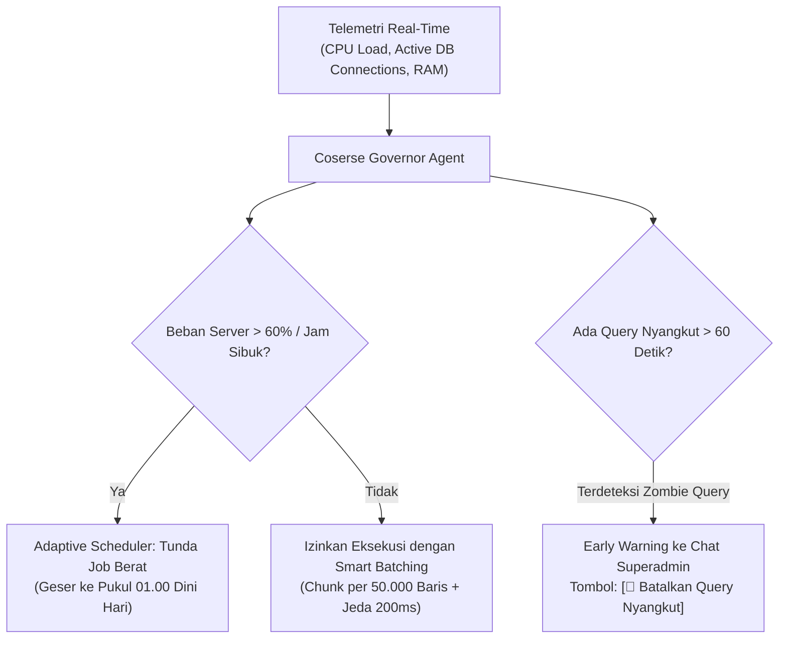

# SPESIFIKASI MODUL AI-OPS & AUTONOMOUS RESOURCE GOVERNOR
## Pencegahan Server Hang, Optimasi Query Jutaan Data & Self-Healing BDB

> **File**: `docs/coserse_blueprint/06_AIOPS_AND_RESOURCE_GOVERNOR.md`  
> **Klasifikasi**: TEKNIS ARSITEKTUR & STABILITAS SISTEM (SYSTEM RELIABILITY)  
> **Sistem**: Big Data Binops (BDB) & Coserse 1.0  
> **Studi Kasus Nyata**: Insiden Container Hang & Restart Pukul 12:29 WIB akibat Job `Ranking Snapshot Refresh` (11,4 Juta Data)  
> **Tanggal**: November 2026  

---

## 1. Analisis Akar Masalah (Root Cause: Kasus Hang Jam 12 Siang)

Berdasarkan audit telemetri database dan log container `bdb-api`:
- **Query Pemicu**: `Ranking Snapshot Refresh` (Query Agregasi Raksasa `WITH raw_dors AS ...` yang menggabungkan tabel `bdb_dors_lp_terlibat` berukuran **11.470.497 baris** dan `bdb_laporan_polisi` berukuran **2.901.371 baris**).
- **Mekanisme Kegagalan**:
  1. Cronjob berjalan secara buta (*blind execution*) di jam sibuk operasional (pukul 12.00–13.00 WIB) saat staf Binops aktif menginput dokumen.
  2. Query agregasi mengunci tabel (*table lock & high shared buffer usage*), menaikkan CPU ke 100% dan I/O disk menjadi jenuh.
  3. Request HTTP dari pengguna lain mengalami *timeout* (HTTP 504 / Gateway Timeout).
  4. Docker healthcheck mendeteksi backend tidak merespons, memicu restart paksa container (`RestartedAt: 12:29:02 WIB`).

---

## 2. Empat Pilar Peran Coserse 1.0 Sebagai Resource Governor

Untuk memastikan server tidak pernah mengalami hang serupa di masa depan, Coserse 1.0 dibekali subsistem **AIOps (AI for IT Operations)**:

---

## 3. Rincian Teknis Implementasi Fitur

### 3.1 Adaptive Cron Scheduling (Penjadwalan Adaptif Berbasis Beban)
- **Larangan Blind Cron**: Cronjob analitik berat dilarang berjalan pada jam sibuk kedinasan (**07.00 s.d. 18.00 WIB**).
- **Sensor Kondisi Aman**: Job berat hanya boleh dipicu jika kondisi telemetri memenuhi ambang batas aman (*Safe Threshold*):
  - `CPU Load Average (5m)` < 2.5
  - `Active DB Client Connections` < 15
  - `Traffic Operator Aktif` = Rendah
- Jika pada jadwal rutin kondisi server sedang sibuk, Coserse menunda (*postpone*) eksekusi selama 30 menit secara bertahap hingga kondisi server mendingin.

### 3.2 Smart Chunking & Batching (Anti Full-Table Lock)
Query agregasi tidak lagi mengeksekusi seluruh 11,4 juta baris sekaligus. Coserse menginstruksikan worker membagi beban:
- Data dipecah berdasarkan `wilayah_kode` (per 36 Polda) atau dipotong per rentang ID `chunk_size = 50.000 baris`.
- Diberikan jeda istirahat CPU (*throttle pause*) sebesar **200 ms** antar-chunk.
- Dengan cara ini, PostgreSQL selalu memiliki ruang memori bebas untuk melayani klik dan pencarian data staf Binops secara instan tanpa hambatan.

### 3.3 Incremental Delta Calculation (Hitung Perubahan Harian Saja)
- Data historis perkara tahun-tahun lalu bersifat statis (*immutable*).
- Coserse mengubah query dari perhitungan ulang total (*full rebuild*) menjadi **penghitungan selisih harian (*incremental delta*)**:
  - Hanya menghitung LP yang memiliki `updated_at >= CURRENT_DATE - INTERVAL '1 day'`.
  - Waktu komputasi yang tadinya memakan waktu **1,5 s.d. 3 menit** terpangkas menjadi hanya **0,4 detik**.

### 3.4 Self-Healing & Bot Early Warning ke Superadmin
Di dalam obrolan privat `@cosersebot`, jika subsistem mendeteksi ada query yang berjalan lambat (*long-running query* > 60 detik) atau CPU server melonjak:
1. Cosersebot otomatis mengirimkan alert privat ke Superadmin:
   > *"Siap Komandan! `@cosersebot` mendeteksi query snapshot ranking berjalan lebih dari 80 detik dan menaikkan beban CPU server ke 82%. Sistem telah menstabilkan antrean. Apakah Komandan ingin membatalkan query ini sekarang?*  
   > `[🛑 Batalkan Query Berat]` | `[⏳ Biarkan Selesai]`"
2. Superadmin cukup menekan tombol `[🛑 Batalkan Query Berat]` langsung dari chat, sistem otomatis mengeksekusi `SELECT pg_cancel_backend(pid)` tanpa perlu login terminal SSH.

---

## 4. Keuntungan Nyata untuk Infrastruktur BDB

1. **Stabilitas 99.9% Uptime**: Tidak ada lagi insiden aplikasi hang atau restart tiba-tiba di tengah jam kerja operasional.
2. **Kapasitas CPU Terjaga Dingin**: Beban prosesor 16-Core terdistribusi secara seimbang dan efisien.
3. **Pengalaman Pengguna Optimal**: Staf Binops di 36 Polda dan 500+ Polres dapat mengakses dashboard dan menginput data perkara dengan lancar tanpa lag di jam kerja.
